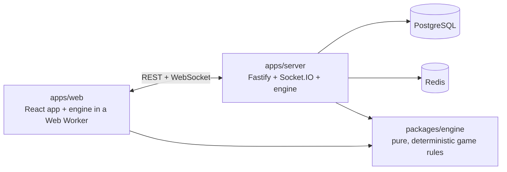

# GRAVITY — Space Mission Design Game

> **Status: 🚧 pre-development.** Planning, repository setup and folder structure are done; no game code exists yet. This README describes the **planned** product and will be updated as features are actually built. See the [roadmap](docs/ROADMAP.md).

GRAVITY is a browser game for the **NASA Space Apps Challenge 2026 — Space Mission Design Game**. Solo or in a team of up to four, players design a complete space mission: pick a science objective, turn it into measurable requirements, design the spacecraft and choose instruments, pick a launch vehicle and orbit, balance **mass, power, budget, data, communications and time**, pass a launch-readiness review, fly the mission, and read a report that explains **why** it succeeded or failed.

*Independent project created for the NASA Space Apps Challenge; not a NASA product.*

## Screenshots / demo

None yet. A demo link and screenshots will be added once the first playable build exists.

## Planned features

| Area | MVP (hackathon) |
| --- | --- |
| Mission setup | 3 scenarios (CubeSat Earth Observer, Lunar Orbiter, Mars Orbiter); Explorer / Engineer / Flight Director difficulty |
| NASA-style flow | Six stages: Need & Goals → Concept → Requirements → Design → Build & Verify → Implement |
| Design | Design Studio with live gauges for six resources, launch-compatibility checks, options that show why they're unavailable |
| Readiness | Green/yellow/red checklist and 5×5 risk matrix that gate launch |
| Simulation | Deterministic six-phase simulation with random events affected by design choices |
| Report | 0–100 score, cause-and-effect explanations, "Try changing…" suggestions |
| Team play | Online co-op for 2–4 players with roles, proposals and a GO/NO-GO vote; hot-seat fallback |
| Learning | Tutorial, glossary, plain-language "why" text; every number labeled `NASA` / `DERIVED` / `GAME` |
| Accessibility | Keyboard play, screen-reader labels, reduced motion, colour-blind-safe palette, phone and tablet layout |

Full list: [docs/FEATURES.md](docs/FEATURES.md).

## Technology stack

TypeScript monorepo (pnpm + Turborepo) · React 18, Vite, Zustand, Tailwind CSS, Radix UI, Recharts, react-three-fiber · Node.js 22, Fastify, Socket.IO · PostgreSQL 16 (Neon) + Drizzle · Redis (Upstash) · BullMQ · Vitest, Playwright · GitHub Actions · Vercel + Fly.io.

Details and trade-offs: [docs/TECH_STACK.md](docs/TECH_STACK.md).

## Architecture overview



Solo play runs entirely in the browser (offline after the first load). Co-op rooms are server-authoritative and use the same engine. More: [docs/ARCHITECTURE.md](docs/ARCHITECTURE.md).

## Prerequisites (planned)

- Node.js 22 LTS
- pnpm 9+
- Docker Desktop (local PostgreSQL and Redis)
- Git

## Installation and running locally

Not available yet. The development environment is set up in **Phase 5**, after which this section will list the exact commands (install, start local services, run migrations, start the dev servers).

## Environment variables

Planned variables are listed in [docs/TECH_STACK.md §3](docs/TECH_STACK.md#3-environment-variables-planned). An `.env.example` file will be added in Phase 5. Never commit a real `.env` file.

## API documentation

Planned REST endpoints and socket events: [docs/API_DOCUMENTATION.md](docs/API_DOCUMENTATION.md).

## Folder structure

```text
apps/web        React web app
apps/server     REST API + Socket.IO rooms
packages/engine game rules (pure, deterministic)
packages/catalog game data (JSON + schemas)
packages/shared types and message schemas shared by both apps
tools/          balance search, GMAT scripts
docs/           planning and reference documentation
resources/      challenge brief and NASA resources guide
```

Every folder has its own README. Full explanation: [docs/FOLDER_STRUCTURE.md](docs/FOLDER_STRUCTURE.md).

## Contributing

Read [CONTRIBUTING.md](CONTRIBUTING.md) and the [Code of Conduct](CODE_OF_CONDUCT.md). To report a vulnerability, see [SECURITY.md](SECURITY.md).

## License and credits

Code is released under the [MIT License](LICENSE). Third-party data and media keep their own terms; every source is listed in the [data ledger](docs/DATA_LEDGER.md).

Built by **Team Gravity** for the NASA Space Apps Challenge 2026. Mission-design concepts come from the NASA and partner resources provided for the challenge (see [docs/RESOURCE_PLAN.md](docs/RESOURCE_PLAN.md)). NASA does not endorse this project.
