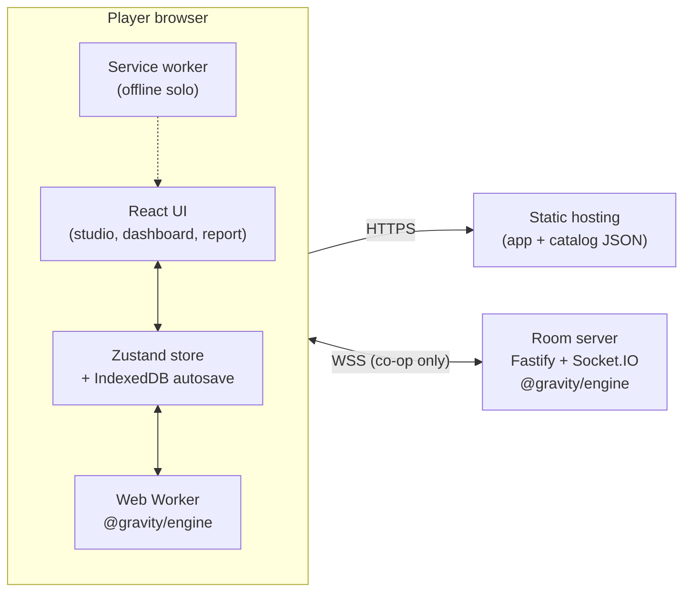
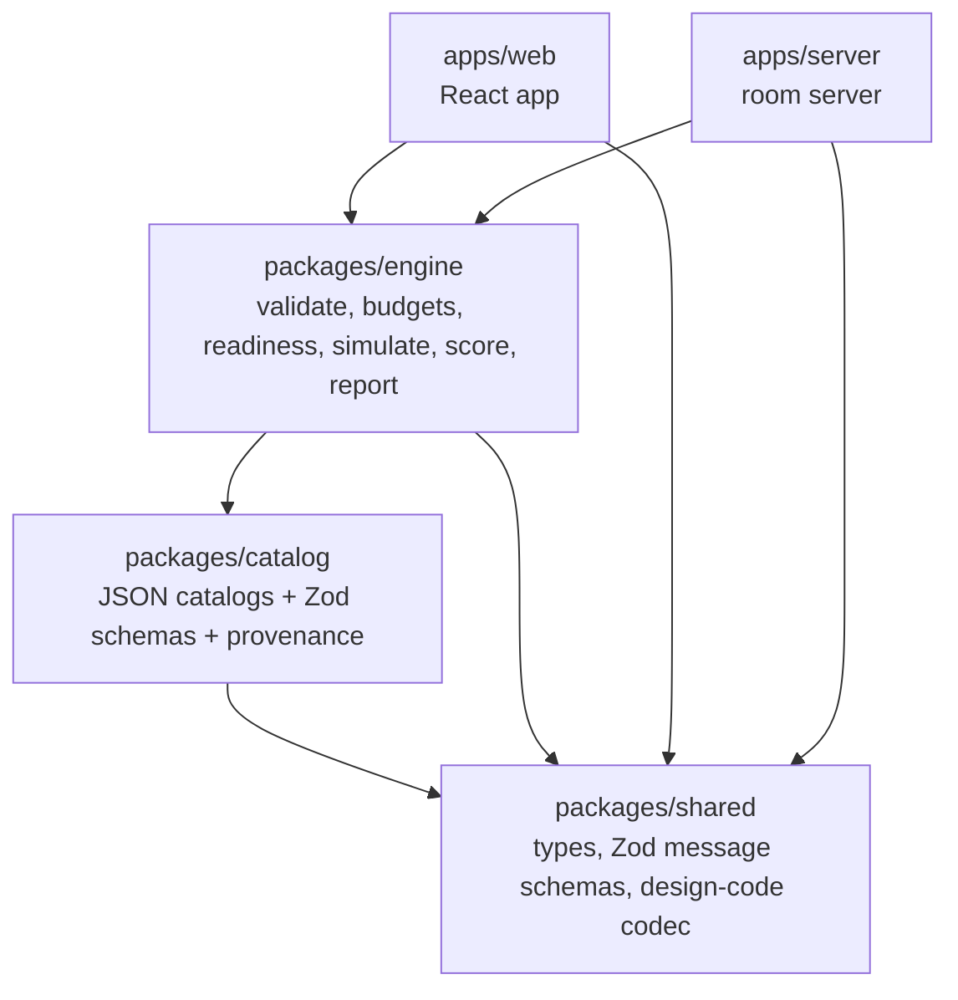
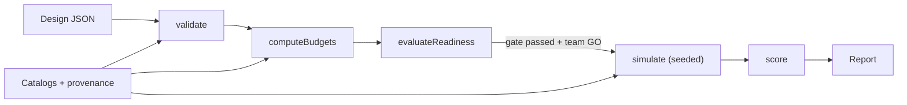
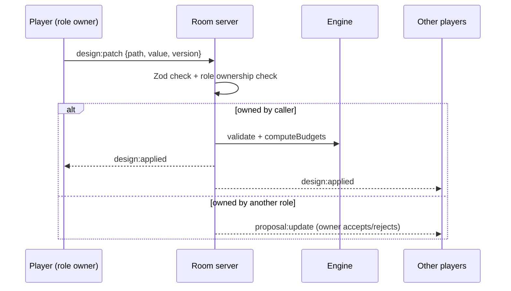

# GRAVITY — Architecture

> Status: **Draft; depends on approval of [TECH_STACK](TECH_STACK.md).** Describes the lean MVP. The full production architecture (database, Redis, jobs, cloud layout, disaster recovery) is Document 3 of [`resources/Gravity.md`](../resources/Gravity.md).

## 1. Principles

1. **Engine first.** All game rules live in one pure, deterministic TypeScript package. The UI and the server are thin layers around it.
2. **Local-first solo play, server-authoritative co-op.** Solo play needs no server. In co-op, the server checks every change with the same engine, so all players see one source of truth.
3. **Data-driven.** Parts, launch vehicles, orbits and scenarios are JSON catalogs, each value labeled with its source (`NASA` / `DERIVED` / `GAME`). Adding a part needs no code change.
4. **Explain everything.** Every engine result records what caused it, so the report can say *why*.
5. **Modular monolith.** One web app, one small server, shared packages. No microservices.

## 2. System context

## 3. Packages

| Package | Responsibility | Depends on |
| --- | --- | --- |
| `packages/shared` | Shared types, Zod schemas for designs and socket messages, design-code encode/decode | — |
| `packages/catalog` | Scenarios, parts, launch vehicles, orbits, requirement templates, similar missions; schema-validated in CI | shared |
| `packages/engine` | Pure functions only (no DOM, no clock, no unseeded randomness) | shared, catalog |
| `apps/web` | UI, state, Web Worker wrapper, service worker | engine, shared |
| `apps/server` | Rooms, roles, proposals, votes, shared simulation start | engine, shared |

> The roadmap's example layout uses `frontend/` and `backend/`. This proposal uses `apps/` + `packages/` because the engine must be shared by both sides. The final structure is decided in Phase 3.

## 4. Engine API

| Function | Purpose |
| --- | --- |
| `validate(design, scenario, catalog)` | List of problems (error / warning / info), each with `why` and `fix` text |
| `computeBudgets(design, scenario, catalog)` | Six resource gauges: used, limit, margin, status, contributing items |
| `deriveRequirements(goals, scenario)` | Measurable requirements, each with a verification method |
| `evaluateReadiness(design, scenario, tier)` | Green/yellow/red checklist and the launch-gate decision |
| `buildRiskMatrix(design, scenario)` | 5×5 likelihood × impact matrix |
| `simulate(design, scenario, catalog, seed, tier)` | Timeline, events, outcome and cause-and-effect trace |
| `score(run, scenario, team)` | Score breakdown, outcome class, cause statements, suggestions |
| `matchAnalogs(design)` | Similar real NASA missions (stretch) |

**Simple models used** (full table in Gravity.md §3.3.1): rocket equation for Δv; solar power falling with distance squared; eclipse fraction per orbit; battery charge and discharge; a simplified communications link budget; per-part reliability; cost totals. Each constant carries a source label.

## 5. Key flows

### 5.1 Solo design loop

Edit → store → worker runs `validate` + `computeBudgets` → gauges and warnings update (< 100 ms) → autosave to IndexedDB.

### 5.2 Co-op change

### 5.3 Launch

All players vote GO → server runs `evaluateReadiness` → `simulate` with a shared seed → broadcasts results → every client renders the same report.

## 6. Socket events (MVP)

| Client → server | Server → client |
| --- | --- |
| `room:create`, `room:join`, `role:claim`, `design:patch`, `proposal:create`, `proposal:respond`, `vote:cast`, `sim:start` | `room:state`, `design:applied`, `design:rejected`, `proposal:update`, `vote:update`, `sim:result` |

Every message is validated with Zod and unknown fields are rejected. Limits: 20 events per second per connection, 5 rooms per hour per client.

## 7. Security and privacy (MVP)

- No accounts and no personal data. Display names come from a preset list or pass a profanity filter; there is no free-text chat.
- The server owns room state and checks role ownership on every patch.
- Leaderboard scores (if built) are recomputed by the server from the design and seed.
- Strict Content-Security-Policy; secrets only in environment variables; `.env` is git-ignored.

## 8. Quality attributes

| Attribute | How it's achieved |
| --- | --- |
| Determinism | Seeded random-number generator; engine is pure; property tests |
| Performance | Engine runs in a worker; 3D lazy-loaded; small critical bundle |
| Offline | Service worker caches the app and catalogs |
| Accessibility | Radix primitives, axe in CI, manual keyboard pass |
| Fault tolerance | Solo play never depends on the server; co-op falls back to hot-seat |
