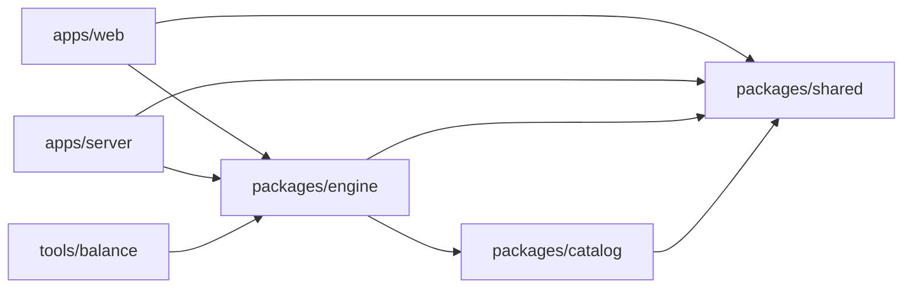

# GRAVITY — Folder Structure

> Status: **✅ Approved by the team (2026-11-14); skeleton created.** Based on the approved [TECH_STACK](TECH_STACK.md) and [ARCHITECTURE](ARCHITECTURE.md). Changes to this structure need team approval.

## 1. Why `apps/` + `packages/` instead of `frontend/` + `backend/`

The simulation engine has to run **in the browser** (offline solo play) **and on the server** (co-op rooms and recomputing leaderboard scores). It must be one shared package, not copied into two folders. A pnpm + Turborepo monorepo handles this with:

- `apps/`: things that run (the web app and the server), the same roles as `frontend/` and `backend/`.
- `packages/`: code both apps import (engine, catalogs, shared types).

| Roadmap example | GRAVITY equivalent |
| --- | --- |
| `frontend/` | `apps/web/` |
| `backend/` | `apps/server/` |
| (no shared folder) | `packages/engine`, `packages/catalog`, `packages/shared` |
| `backend/src/controllers`, `routes`, `models`, `services` | `apps/server/src/modules/<feature>/` (route, service, repository together per feature) |
| `frontend/src/pages`, `components`, `hooks`, `services` | `apps/web/src/features/<feature>/` + shared `components/`, `hooks/`, `lib/` |

Grouping by **feature** (rooms, scores, studio, report) rather than by file type keeps related code together and makes ownership clear in a team of 4–5.

## 2. Proposed tree

```text
Team-Gravity/
├── apps/
│   ├── web/                         # React + Vite single-page app
│   │   ├── public/                  # favicon, PWA manifest, static images, 3D models (glTF)
│   │   ├── src/
│   │   │   ├── app/                 # entry, router, providers, error boundary, layout shell
│   │   │   ├── features/
│   │   │   │   ├── scenarios/       # scenario + difficulty picker, Mission Brief, goals
│   │   │   │   ├── requirements/    # Science Traceability Matrix, requirements + verification, MEL
│   │   │   │   ├── studio/          # parts browser, gauges, 2D/3D craft view, launch + orbit picker
│   │   │   │   ├── readiness/       # G/Y/R checklist, 5×5 risk matrix, launch gate
│   │   │   │   ├── simulation/      # live dashboard, speed controls, decision modal
│   │   │   │   ├── replay/          # 2D (and 3D) mission replay
│   │   │   │   ├── report/          # score breakdown, causal chains, suggestions, analogs
│   │   │   │   ├── trade-space/     # trade-space chart, sensitivity view
│   │   │   │   ├── rooms/           # lobby, roles, proposals, GO/NO-GO, hot-seat mode
│   │   │   │   ├── leaderboard/
│   │   │   │   └── education/       # tutorial, glossary, static facts panel, About page
│   │   │   ├── components/          # shared UI built on Radix (Button, Dialog, Gauge…)
│   │   │   ├── hooks/               # shared React hooks
│   │   │   ├── lib/                 # API client, socket client, design-code helpers
│   │   │   ├── store/               # Zustand slices + Dexie (IndexedDB) persistence
│   │   │   ├── workers/             # engine.worker.ts (runs @gravity/engine off the main thread)
│   │   │   ├── i18n/                # i18next setup + en strings
│   │   │   └── styles/              # Tailwind entry, design tokens, themes (high contrast)
│   │   ├── e2e/                     # Playwright tests
│   │   ├── index.html
│   │   ├── vite.config.ts
│   │   └── package.json
│   │
│   └── server/                      # Node.js 22 + Fastify + Socket.IO
│       ├── src/
│       │   ├── main.ts              # boot, graceful shutdown
│       │   ├── config/              # Zod-validated environment variables
│       │   ├── plugins/             # auth (JWT), rate limit, CORS, error mapper, Sentry
│       │   ├── modules/             # one folder per feature: routes + service + repository
│       │   │   ├── auth/            # POST /auth/guest (OAuth post-MVP)
│       │   │   ├── catalogs/        # GET /catalogs/:version
│       │   │   ├── simulate/        # POST /simulate
│       │   │   ├── scores/          # POST /scores (recompute), leaderboards
│       │   │   ├── rooms/           # REST create/join + room lifecycle
│       │   │   └── health/          # /healthz, /readyz
│       │   ├── realtime/            # Socket.IO gateway, event handlers, Redis adapter
│       │   ├── jobs/                # BullMQ queues and workers
│       │   └── db/
│       │       ├── schema/          # Drizzle table definitions
│       │       └── migrations/      # generated SQL migrations (0001_init…)
│       ├── tests/                   # integration tests (Testcontainers: Postgres + Redis)
│       ├── Dockerfile
│       └── package.json
│
├── packages/
│   ├── engine/                      # @gravity/engine: PURE, deterministic, no DOM/clock/IO
│   │   ├── src/
│   │   │   ├── models/              # Δv, power, comms, cost, reliability formulas
│   │   │   ├── validate/
│   │   │   ├── budgets/
│   │   │   ├── requirements/        # deriveRequirements
│   │   │   ├── readiness/           # evaluateReadiness, buildRiskMatrix
│   │   │   ├── simulate/            # phases, events, seeded PRNG
│   │   │   ├── score/               # scoring, causal statements, suggestions
│   │   │   └── index.ts             # public API
│   │   ├── tests/                   # unit + property tests (Vitest, fast-check)
│   │   └── package.json
│   ├── catalog/                     # @gravity/catalog: data, not code
│   │   ├── data/                    # scenarios, parts, launch-vehicles, orbits,
│   │   │                            # requirement-templates, analogs, trajectories (*.json)
│   │   ├── src/                     # Zod schemas, loader, provenance types
│   │   └── package.json
│   └── shared/                      # @gravity/shared: types, socket/REST Zod schemas,
│       ├── src/                     # role→path ownership map, design-code codec
│       └── package.json
│
├── tools/
│   ├── balance/                     # script proving ≥3 viable designs per scenario
│   └── gmat/                        # GMAT scripts + export notes (output/ is git-ignored)
│
├── docs/                            # planning docs (this folder) + later:
│                                    # API_DOCUMENTATION.md, DATA_LEDGER.md, adr/ (decision records)
├── resources/                       # challenge brief, resources guide, Gravity.md (reference)
│
├── .github/
│   ├── workflows/                   # ci.yml (lint, format, typecheck, test, build, audit) + codeql.yml; validation only
│   ├── ISSUE_TEMPLATE/              # bug report, feature request
│   ├── PULL_REQUEST_TEMPLATE.md
│   ├── dependabot.yml               # weekly dependency + Actions update PRs (never auto-merged)
│   └── CODEOWNERS
│
├── .claude/
│   └── settings.json                # shared Claude Code permissions (Phase 6)
│
├── .editorconfig  .gitattributes  .gitignore      # ✅ Phase 2
├── .env.example                     # documented variables, no secrets (Phase 5)
├── .prettierrc.json  eslint.config.js  # formatting + lint (Phase 5)
├── tsconfig.base.json               # shared strict TypeScript settings (Phase 5)
├── docker-compose.yml               # local Postgres 16 + Redis (Phase 5)
├── package.json                     # root scripts: dev, build, lint, test, typecheck
├── pnpm-workspace.yaml              # apps/*, packages/* (tools/* added when a tool gets a package.json)
├── turbo.json                       # task pipeline + caching
├── CLAUDE.md                        # Claude Code rules + strict Git restrictions (Phase 6)
├── README.md  CONTRIBUTING.md  SECURITY.md  CODE_OF_CONDUCT.md  # Phase 4
└── LICENSE                          # ✅ MIT
```

## 3. Dependency rules between folders



| Rule | Why |
| --- | --- |
| `packages/*` never import from `apps/*` | Shared code stays independent of any one app |
| `packages/engine` has no DOM, network, clock or unseeded randomness | Same result every time, in browser and server |
| `apps/web` never imports `apps/server` (and vice versa) | They talk only through REST/Socket.IO schemas in `packages/shared` |
| Catalog values live only in `packages/catalog/data/*.json` | Data changes need no code changes; each value carries a `NASA` / `DERIVED` / `GAME` label |
| Tests sit next to their package (`tests/`, `e2e/`) | Each package can be tested on its own |

## 4. What is intentionally **not** included

| Left out | Reason |
| --- | --- |
| `develop` branch folders or per-environment config folders | Branch model is `main` + `feature/*`; config comes from environment variables |
| `infra/` (Terraform etc.) | Hosting is managed platforms (Vercel, Fly.io, Neon, Upstash); a `fly.toml` is added only when deployment is approved |
| Separate `controllers/` / `models/` folders | Replaced by feature modules (see §1) |
| `apps/admin` | Admin tooling is post-MVP |
| Deployment workflows in `.github/workflows/` | CI validates only; deploys need explicit approval |

## 5. Skeleton status

**Created (Phase 3):** 54 folders under `apps/`, `packages/` and `tools/`, each with a short `README.md` stating its purpose and rules (Git doesn't track empty folders, and a README is more useful than a `.gitkeep`).

**Added in later phases:**

| Phase | Files |
| --- | --- |
| 4 Documentation | `README.md`, `CONTRIBUTING.md`, `SECURITY.md`, `CODE_OF_CONDUCT.md`, `.github/PULL_REQUEST_TEMPLATE.md`, `.github/ISSUE_TEMPLATE/`, `.github/CODEOWNERS`, `docs/DATA_LEDGER.md`, `docs/API_DOCUMENTATION.md` |
| 5 Dev environment | Root `package.json`, `pnpm-workspace.yaml`, `turbo.json`, `tsconfig.base.json`, `eslint.config.js`, `.prettierrc.json`, `.prettierignore`, `.nvmrc`, `.env.example`, `docker-compose.yml`, `docs/DOCKER_SETUP.md`; plus `package.json`, `tsconfig.json`, a placeholder `src/` and a smoke test in every package and app |
| 6 Claude Code | `CLAUDE.md`, `.claude/settings.json` |
| 7 Validation | `.github/workflows/ci.yml`, `.github/workflows/codeql.yml`, `.github/dependabot.yml` |

**Still to come, with real content:**

| Path | When | Why not now |
| --- | --- | --- |
| `apps/web/public/` | Phase 8 | Added with the first real static asset (a README there would be copied into the built site) |
| `apps/web/playwright.config.ts` | Phase 8 | Added with the first end-to-end flow |
| `apps/server/Dockerfile`, `fly.toml` | When deployment is approved | No deployment yet |
