# GRAVITY — Space Mission Design Game

*Software Architecture Planning Package for NASA Space Apps Challenge 2026 · Challenge: Space Mission Design Game · Platform: Web*

This package contains four documents in order: **(1) Product Requirements Document**, **(2) Software Requirements Specification**, **(3) System Design Document**, **(4) Implementation Plan**.

## 0. Planning Notes (read first)

### 0.1 Source of the requirements

Requirements come from two team documents in `resources/`: **`challenge.docx`** (the NASA Space Apps Challenge 2026 *Space Mission Design Game* statement: background, objectives, potential considerations) and **`resource.docx`** (the categorized NASA and partner resources guide). §0.5–0.10 record what the resources change; Documents 1–4 have been reconciled with them. Judging criteria are not part of either document, so scoring follows the challenge's own list: reward effective engineering decisions, efficient resource management, successful collaboration, and achievement of mission objectives.

### 0.2 Project in one paragraph

**GRAVITY** is a browser-based game for 1–4 players. The team picks a science objective, designs a spacecraft and payload, chooses a launch vehicle and orbit, balances six resources (mass, power, budget, data, communications, time), then runs a simulated mission. A post-mission report explains, with cause-and-effect chains, *why* the mission succeeded or failed. There is no single perfect answer: the objective comes first and every choice has an explicit consequence.

### 0.3 Recommended technology stack (applies to all four documents)

| Layer | Choice | Why this choice | Alternative and trade-off |
| --- | --- | --- | --- |
| Language | **TypeScript** end to end | One language lets the simulation engine run identically in browser and server; fastest for a 48-hour hackathon | Python backend: better science libraries, but duplicates the engine |
| Frontend | **React 18 + Vite + Zustand + Tailwind + Radix UI** | Fast iteration; Radix gives accessible primitives (keyboard, ARIA) out of the box | SvelteKit: lighter, but smaller component ecosystem |
| 3D / visuals | **react-three-fiber + drei (Three.js)**, **Recharts** for gauges and charts | Interactive spacecraft and orbit views with little boilerplate | Plain Canvas 2D: cheaper on low-end devices (kept as a low-power fallback) |
| Simulation engine | **Pure TypeScript package** (`@gravity/engine`), seeded PRNG, runs in a **Web Worker** | Deterministic, testable, reusable for solo (offline) and multiplayer (server-authoritative) | WASM/Rust: faster, unnecessary at this scale |
| Backend | **Node.js 22 + Fastify + Socket.IO + Zod** | Real-time rooms for up to 4 players; Zod validates every payload | Colyseus: richer game-room features, steeper learning curve |
| Database | **PostgreSQL (Neon) + Drizzle ORM** | Relational fit for designs, runs, rooms, scores; JSONB for flexible design documents | Supabase: faster to start, but couples auth and realtime to a vendor |
| Cache / realtime state | **Redis (Upstash)** | Room state, leaderboard sorted sets, rate limiting, NASA API response cache | In-memory only: loses state on restart |
| Hosting | **Vercel** (static web) + **Fly.io** (WebSocket server) | Free/cheap tiers, global edge, WebSocket-friendly | Render or Railway: simpler UI, fewer regions |
| CI/CD | **GitHub Actions**, Vitest, Playwright | Standard, free for public repos | GitLab CI: no advantage here |
| Monitoring | **Sentry** (errors), **Better Stack** or **Grafana Cloud** (logs/metrics), **PostHog** (privacy-friendly analytics) | Low-effort, generous free tiers | Self-hosted Prometheus: more control, more ops work |
| AI (optional, post-MVP) | **Claude API** behind a server proxy for a "Mission Mentor" coach | Explains results in plain language; grounded on the deterministic report so it cannot invent physics | Rule-based explanations only (this is the MVP default) |

**Key architectural decision:** single-player runs **fully client-side** (no server needed, works offline and in classrooms with poor connectivity). Multiplayer adds a **server-authoritative** room that uses the same engine package.

### 0.4 Resources review: outcome of the original checklist

| Item | Outcome from `resource.docx` |
| --- | --- |
| Datasets (launch vehicles, instruments, orbits, planetary data) | **None provided.** The resources are frameworks, tools and example games, not datasets. Catalog values in §3.7.1 stay `GAME`/`DERIVED` until sourced; GMAT can generate Δv and trajectory values (§0.5) |
| Required or recommended APIs | **None listed.** No live NASA API is part of the resources, so the live data panel is moved to Future scope (§0.9) |
| Licensing and attribution rules | Not stated per resource; follow each website's data-use terms and record them in the data ledger |
| Submission format (video, link, repository) | Not in the documents; confirm with mentors (§0.10) |

### 0.5 Resources Review: What Each Resource Gives Us

| Resource | Key content | How GRAVITY uses it |
| --- | --- | --- |
| **Design and Develop Science Missions** (NASA webinar, Mar 2025) | A mission has four segments: **launch, space, ground, user**. Six-step process: **Identify Need and Goals → Define Concept → Define Requirements → Design → Build and Verify → Implement**. A Concept of Operations (ConOps) is time-sequenced and drives requirements. "Begin with the end in mind": the science product defines what is needed. Requirements are measurable and each has a planned verification (example: a container under 250 g is verified by weighing it). Worked example: BioNutrients-2 (needs, goals, quantified requirements such as at least 12 replicate samples, at least 30 mL per sample, under 300 mL occupied volume). Example missions named: PUNCH, PILOT, Dawn, Mars Moon Sampler, SLS, Artemis | **The game flow itself.** Our six game stages mirror the six steps; the four segments organize the studio, dashboard and report; every requirement carries a verification method; the ConOps becomes a timeline screen |
| **Concept Maturity Levels paper** (JPL, Wessen et al.) | CML 1 Cocktail Napkin, CML 2 Initial Feasibility, CML 3 Trade Space, CML 4 Point Design. Iterative loop between CML 2–4. Checklist with green/yellow/red status; a concept counts as at a level at about **80% green**, but missing critical items (Science Traceability Matrix, Level 1 requirements, Master Equipment List) overrides the percentage. Checklist examples: dry-mass and power margins of at least 35%, energy at least 35%, flight software timing/memory at least 100%, telecom link margin at least 3 dB (deep space) or 6 dB (proximity), 5×5 risk matrix, launch period 20 days. Caveats: it measures completeness not quality, and self-assessment is over-optimistic | **Difficulty ladder and readiness gate.** Difficulty tiers map to CML levels; a live readiness checklist (G/Y/R) gates launch; the engine acts as the independent assessor the paper recommends; margin policy and risk matrix come from the checklist |
| **Mission Design Lab (MDL)** (NASA rapid collaborative assessment) | Evaluates complete mission architectures and spacecraft disciplines across four study tiers: **Office Hours** (quick brainstorming, identify major challenges), **Concept Development** (feasibility and risk assessment), **Trade Studies** (compare architectures and design options), **Point Design** (detailed design with CAD models, equipment lists, engineering models and cost estimates) | **Co-op model and difficulty ladder.** The four-player team works like an MDL study team (one discipline per role, decisions made together); the MDL tiers align with the CML-based difficulty tiers (§0.6.4); the Point Design deliverables (equipment list, cost estimate) become the Master Equipment List and cost views |
| **GMAT** (General Mission Analysis Tool) | Open-source NASA tool for trajectory design, Δv, maneuvers, launch windows, from LEO to deep space. It is desktop software, not a web app | **Offline data generator, not a runtime dependency.** Run GMAT scripts once per scenario, export Δv budgets, transfer times and trajectory samples to JSON catalogs labeled `NASA/GMAT`. The browser engine reads those tables |
| **NASA Mission Viz** (Web-based Space Mission Visualization) | Tutorials and demos (X3DOM/WebGL) that turn GMAT trajectory data into interactive web visualizations, including an Earth–Moon trajectory demo | **Reference pipeline for the replay view:** GMAT export → JSON → animated 3D trajectory. We use react-three-fiber for consistency with our stack; verify the repository license before copying any code |
| **A Learning Game About Telescopes** (Build It Yourself: Satellite) | Objectives first, then wavelengths, instruments, optics; incompatible options are grayed out; three levels of rising complexity; animated launch; result screen names **real NASA missions with similar data**. Needs at least 1024×768 screen, not phone-friendly; no built-in accessibility (transcript only) | **Patterns to adopt:** disabled options with a reason, level progression, launch animation, real-mission match in the report. **Our gaps to fill:** mobile support and full accessibility |
| **CubeSat 101** (CSLI guide) | Basic concepts and processes for first-time CubeSat developers (created primarily for CSLI), covering every phase of a CubeSat mission from ConOps to launch and operations. *Only the summary has been reviewed so far, not the full guide* | Beginner scenario (CubeSat in LEO), tutorial wording, glossary terms |
| **Visualize a Space Mission Using VR** (2023 challenge) | Asked for mission concept, orbital trajectories, timeline and 3D visualization | Confirms the four ingredients of our **Mission Replay** view; WebXR stays a stretch goal |
| **CSA digital games and activities** | Games, e-books and activities for learners of all ages | Educational-design inspiration only; no data dependency |
| **Resources-tab disclaimer** | NASA does not endorse non-U.S. Government entities; participants must follow each website's data-use terms | Per-source attribution and license column in the data ledger; About page lists each source |

### 0.6 Final Solution Plan

#### 0.6.1 Product concept (final)

**GRAVITY** teaches system-level mission design the way NASA does it: start from the science, derive measurable requirements, design across four segments, verify, then launch and see what the data returns. Every decision is traceable from **science goal → requirement → design choice → result**, and the report ends by matching the player's design to **real NASA missions** with similar characteristics.

#### 0.6.2 Game flow (replaces the flow in §1.5 and §2.3)

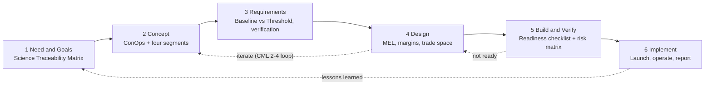

| Stage | What the player does | Screen / feature | Source idea |
| --- | --- | --- | --- |
| 1 Need and Goals | Pick science goals; see a Science Traceability Matrix (goal → measurement → instrument) fill in | Mission Brief | CML science rows; telescope game (objectives first) |
| 2 Concept | Define the four segments (launch vehicle, spacecraft type, ground stations/ops, data users) and a ConOps timeline | Concept board + timeline | Webinar segments, ConOps |
| 3 Requirements | Set Baseline and Threshold science levels; the game proposes measurable requirements, each with a verification method | Requirements table | Webinar (end in mind, verify), CML 4 (baseline/threshold) |
| 4 Design | Choose parts (the Master Equipment List), orbit, Δv; watch margins; explore the trade space | Design Studio + Trade-Space chart | CML 3–4, telescope game (grayed-out options) |
| 5 Build and Verify | Clear the readiness checklist (G/Y/R) and a 5×5 risk matrix; mitigate risks | Readiness gate | CML checklist |
| 6 Implement | Team GO/NO-GO, launch, operate, read the report | Simulation, Mission Replay, Report | Webinar, VR challenge, telescope game (real-mission match) |

#### 0.6.3 Roles mapped to segments (co-op)

| Role | Segment ownership | Owns |
| --- | --- | --- |
| Mission Architect | Launch segment + concept | Goals, ConOps, orbit, launch vehicle, requirements |
| Spacecraft Engineer | Space segment (platform) | Bus, propulsion, attitude control, computer, mass and Δv |
| Science Lead | Space segment (payload) + user segment | Instruments, data products, science return |
| Operations and Resources | Ground segment | Power, communications and ground contacts, budget, schedule |

#### 0.6.4 Difficulty tiers mapped to concept maturity

| Tier | Maps to (CML / MDL tier) | Rules |
| --- | --- | --- |
| **Sandbox** | No gate | Relaxed limits, any catalog item, scoring off (SRS-MIS-05) |
| **Explorer** | CML 1–2 / Office Hours + Concept Development | Requirements auto-filled; margin warning below 10% (`GAME`); simple parts; hints on |
| **Engineer** | CML 3 Trade Space / Trade Studies | Player edits requirements; margin target 20% (`GAME`); trade-space chart; readiness gate at 80% green |
| **Flight Director** | CML 4 Point Design / Point Design | Margin target **35%** on dry mass, power and energy (`NASA/JPL CML 4 checklist`); link margin at least 3 dB deep space or 6 dB proximity; 5×5 risk matrix; Master Equipment List complete; critical-items rule; more random events |

#### 0.6.5 Success and scoring (refines §2.3.6)

- **Full success** = Baseline science met; **Partial** = Threshold met; **Failure** = below Threshold or an unrecoverable fault.
- Score components stay 30 / 25 / 15 / 15 / 15; **Decision quality** now includes readiness-checklist completeness and risk mitigation; **Resource efficiency** uses the margin policy of the chosen tier.
- The readiness gate is evaluated by the **engine** (independent assessor), never self-reported.

### 0.7 New and Changed Requirements (extend the SRS)

| ID | Requirement | Priority |
| --- | --- | --- |
| SRS-PRC-01 | The game MUST follow the six-stage flow in §0.6.2; stages 3 and 5 are auto-assisted on Explorer | Must |
| SRS-PRC-02 | The studio, dashboard and report MUST group items by the four segments (launch, space, ground, user) | Must |
| SRS-PRC-03 | A ConOps timeline (ordered mission events with durations) MUST be shown and editable at Engineer level and above | Should |
| SRS-REQ-01 | Requirements MUST be measurable, and each MUST list a verification method (test, analysis, inspection or demonstration) and a pass/fail result in the report | Must |
| SRS-REQ-02 | Each scenario MUST define a **Baseline** and a **Threshold** science level; outcome classes derive from them | Must |
| SRS-TRC-01 | A Science Traceability Matrix (goal → measurement → instrument → requirement) MUST be generated live from the design | Must |
| SRS-MEL-01 | A Master Equipment List view MUST list every item with mass, power, cost and margin contribution | Must |
| SRS-CML-01 | Difficulty tiers MUST follow §0.6.4 | Must |
| SRS-CML-02 | A readiness checklist (green/yellow/red per item) MUST gate launch: at least 80% green AND all critical items green | Must |
| SRS-CML-03 | Checklist status MUST be computed by the engine; the UI MUST explain each red item with the fix | Must |
| SRS-CML-04 | The player MUST be able to return to any earlier stage without losing work (CML 2–4 iteration loop) | Must |
| SRS-MRG-01 | Margin policy MUST follow the tier table; the telecom margin MUST be shown in dB | Must |
| SRS-TRD-01 | A Trade-Space chart MUST plot the player's saved designs (cost vs. science return, marker = risk level) | Must |
| SRS-TRD-02 | A sensitivity view SHOULD show how science return changes when one parameter (mass, data volume, orbit) is varied ("science partials") | Should |
| SRS-RSK-01 | A 5×5 risk matrix MUST be generated from the design and events; mitigations selected by the player MUST change event outcomes | Must (Flight Director), Should (others) |
| SRS-ANA-01 | The report MUST list at least two **real NASA analog missions** matched on target, orbit class and instrument types, with a source link | Should |
| SRS-UI-01 | Options incompatible with earlier choices MUST be shown disabled with a visible reason (not hidden) | Must |
| SRS-VIZ-01 | A Mission Replay MUST animate concept → trajectory → timeline in 2D, with an optional 3D mode | Must (2D), Could (3D) |
| SRS-VIZ-02 | Trajectories SHOULD come from GMAT-exported JSON; fallback is analytical (Hohmann-type) curves labeled `DERIVED` | Should |
| SRS-DAT-01 | The data ledger MUST record source, license/terms and provenance label for every dataset, and the About page MUST list them | Must |
| SRS-ACC-01 | Tutorials MUST have text transcripts and the whole game MUST work on phones and tablets | Must |

**Data model:** no new tables. Extend the design JSON with `goals[]`, `requirements[]` (each with `verification`), `segments{launch,space,ground,user}`, `conops[]`, `risks[]`, `readiness{}`. **New catalogs:** `requirement-templates.json`, `analogs.json`, `trajectories/*.json` (GMAT-derived), each with provenance and license fields. **New engine functions:** `deriveRequirements`, `evaluateReadiness`, `buildRiskMatrix`, `matchAnalogs`, `sensitivity`.

**Folder additions:** `tools/gmat/` (scripts and export notes), `packages/catalog/analogs/`, `packages/catalog/trajectories/`, `apps/web/src/features/{requirements,readiness,trade-space,replay}/`.

### 0.8 Scenarios (final MVP set)

| # | Scenario | Level | Why |
| --- | --- | --- | --- |
| 1 | **CubeSat Earth Observer in LEO** | Explorer / tutorial | Small budget, matches CubeSat 101 and the "access to space for all" theme; teaches mass, power, downlink |
| 2 | **Lunar Orbiter** | Engineer | Introduces Δv, launch capacity and the 20-day launch period concept |
| 3 | **Mars Orbiter** | Flight Director | Communications and power (solar flux falls with distance) become the critical resources |

Stretch: a **constellation** scenario (several identical small satellites, as in PUNCH), and a **multi-target** scenario inspired by Dawn.

### 0.9 Plan Updates (adjust Document 4)

| Phase | Change | Effort |
| --- | --- | --- |
| 0 | Assign one **data and science owner**; confirm license/terms for GMAT, Mission Viz and image sources; start the data ledger with columns source / terms / provenance | +1 h |
| 2 Engine | Add requirement templates, margin policy, readiness evaluator, analog catalog (curated list, about 10 missions) | +4 h |
| 3 Studio | Six-stage navigator, Traceability Matrix and MEL views, disabled-with-reason options | +3 h |
| 4 Simulation | Trade-space chart, 5×5 risk matrix, 2D Mission Replay | +4 h |
| 6 Polish | Tutorial transcripts, mobile layout pass | +1 h (inside existing budget) |

**GMAT in a 48-hour window:** treat it as a **stretch**. First ship analytical Δv and transfer values labeled `DERIVED`. If the data owner can run GMAT, replace the Lunar (and then Mars) values and export one trajectory for the replay. Do not let GMAT installation block the critical path.

**Revised cut lines (in order):** 1) 3D replay (keep 2D); 2) sensitivity view; 3) leaderboard; 4) Mars scenario; 5) real-time rooms → hot-seat co-op. **Demoted to Future:** the live NASA data panel (APOD, NeoWs, DONKI) is not part of the provided resources, so it no longer competes for hackathon time. The MVP keeps a **static facts panel** (bundled, source-labeled facts such as planetary distance and solar flux).

**Never cut:** six-stage flow, requirements with verification, Baseline/Threshold outcome, readiness gate, four-segment grouping, causal report, provenance labels, accessibility basics.

### 0.10 Three-Minute Demo Script and Open Items

**Demo script:** (1) pick the Lunar Orbiter goals and show the Traceability Matrix; (2) show the four-segment ConOps; (3) accept Baseline/Threshold requirements and point out the verification methods; (4) build a design, trigger a grayed-out option with its reason, watch margins turn red; (5) plot two designs on the Trade-Space chart; (6) readiness checklist shows red items, fix them; (7) four-player GO/NO-GO; (8) launch and Mission Replay; (9) report: outcome class, causal chain, matched real NASA missions.

**Open items to close with mentors or on the Resources tab:**

- Judging criteria and the submission format (video length, links).
- License terms for the Mission Viz code and GMAT outputs before reuse.
- CubeSat 101 and the CSA games were not read in detail; skim them for glossary content and age-appropriate wording.
- Curate the analog-mission list and confirm each link and fact before showing it to players.
- Replace all `GAME` catalog values with sourced values wherever time allows.

---

# Document 1 — Product Requirements Document (PRD)

## 1.1 Project Title

**GRAVITY — a Space Mission Design Game**.

## 1.2 Executive Summary

Space missions succeed or fail on trade-offs: a better instrument adds science value but also mass, power, data volume and cost. Most educational tools teach one slice (orbits, rockets, or subsystems), so learners understand concepts but cannot make system-level decisions. GRAVITY closes that gap with a complete, end-to-end mission design loop in the browser: **define the objective → design the spacecraft and payload → pick launch vehicle and orbit → manage constraints → simulate → learn from a causal debrief.** It supports solo play and a cooperative mode for up to four players with distinct roles.

## 1.3 Vision Statement

Anyone, from a curious student to an aspiring engineer, should be able to feel what it is like to be a mission designer, and leave understanding *why* engineers make the choices they do.

## 1.4 Problem Statement

- Mission design decisions are strongly interdependent, but learning materials treat them separately.
- Trade-offs are usually taught as theory; learners rarely get to make a mistake, see the consequence, and iterate.
- Existing sandboxes are either very deep (steep learning curve) or very shallow (no real constraints).

## 1.5 Proposed Solution

A web game with:

1. A **mission brief** that sets the science objective before any technical choice.
2. A **design studio** (spacecraft bus, power, comms, computer, attitude control, instruments, launch vehicle, orbit) with live resource gauges.
3. A **compatibility and readiness check** (mass vs. launch capacity, power vs. instruments, data vs. downlink).
4. A **mission simulator** with phases, random events and a live dashboard.
5. A **post-mission report** that traces failures to specific decisions and suggests what to change.
6. **Cooperative roles** for up to four players, a **sandbox**, **leaderboard**, and **shareable design codes**.

## 1.5.1 Target Users

| Segment | Description | Primary need |
| --- | --- | --- |
| Students (ages 12–18) | Beginner/youth audience in the challenge | Guided, visual, forgiving |
| University students and hobbyists | Intermediate | Realistic constraints, replayability |
| Teachers and mentors | Run it in class | Offline-friendly, shareable scenarios, no accounts required |
| Hackathon judges and NASA community | Evaluate the entry | Clear science, clear data provenance, polished demo |

## 1.5.2 User Personas

| Persona | Profile | Goals | Frustrations |
| --- | --- | --- | --- |
| **Aarav, 14, student** | Loves space, no engineering background | Launch something that works; understand why it failed | Jargon, long tutorials |
| **Meera, 20, aerospace undergrad** | Knows the rocket equation | Explore trade spaces, compare designs | Games that ignore real constraints |
| **Mr. Kulkarni, high-school teacher** | 30 students, weak Wi-Fi | Run a team-based class activity | Logins, installs, unpredictable behavior |
| **Team of four friends** | Playing remotely | Split roles, argue priorities, win together | Waiting on each other, unclear ownership |

## 1.6 User Stories

| ID | As a… | I want to… | So that… |
| --- | --- | --- | --- |
| US-01 | player | choose a mission objective first | my technical choices have a purpose |
| US-02 | player | add and remove spacecraft components and see mass, power, cost update live | I understand each trade-off immediately |
| US-03 | player | choose a launch vehicle and orbit with plain-language descriptions | I learn what each option means for coverage and communications |
| US-04 | player | be warned when my design is incompatible (e.g. too heavy for the rocket) | I can fix it before launch |
| US-05 | player | run the simulation and watch a live dashboard | I see how my design behaves over time |
| US-06 | player | read a report explaining why the mission succeeded or failed | I learn from it |
| US-07 | player | edit my design and re-run unlimited times | I can iterate |
| US-08 | beginner | pick an easy difficulty with guided tutorials | I am not overwhelmed |
| US-09 | advanced player | pick a hard difficulty with tighter margins and random events | I stay challenged |
| US-10 | team member | take a role (Mission Architect, Spacecraft Engineer, Science Lead, Operations) | we share responsibility |
| US-11 | team | hold a final GO/NO-GO vote before launch | decisions are shared |
| US-12 | player | share a design as a link or code | friends or students can load and compare it |
| US-13 | player | see a leaderboard per scenario | I can compare results |
| US-14 | teacher | play with no account and no install | class time is not wasted |
| US-15 | player with a disability | use keyboard, screen reader and reduced motion | I can play fully |
| US-16 | player | open a sandbox with relaxed constraints | I can experiment freely |

## 1.7 Functional Requirements (summary; detailed in SRS)

| ID | Requirement | Priority |
| --- | --- | --- |
| FR-01 | Scenario selection with objectives, difficulty and constraints | Must |
| FR-02 | Design studio for bus, power, batteries, comms, computer, attitude control, instruments | Must |
| FR-03 | Launch vehicle and orbit selection with compatibility checks | Must |
| FR-04 | Six live resources: mass, power, budget, data, communications, time | Must |
| FR-05 | Deterministic mission simulation with phases and random events | Must |
| FR-06 | Scoring across performance, science value, efficiency, decision quality, collaboration | Must |
| FR-07 | Post-mission causal report | Must |
| FR-08 | Single-player mode, fully offline-capable | Must |
| FR-09 | Cooperative mode, 1–4 players, role-based permissions, shared decisions | Must |
| FR-10 | Save, load, duplicate, compare and share designs | Should |
| FR-11 | Leaderboard per scenario and difficulty | Should |
| FR-12 | Tutorials, glossary, "why does this matter?" tooltips | Must |
| FR-13 | Sandbox mode | Should |
| FR-14 | Competitive mode (teams on the same objective) | Could |
| FR-15 | Static facts panel with source labels (NASA data vs. derived vs. game model); live NASA feeds are Future scope | Should |
| FR-16 | Accessibility: keyboard, screen reader, reduced motion, color-blind-safe palette | Must |

## 1.8 Non-Functional Requirements

| Category | Target |
| --- | --- |
| Performance | Initial load under 3 s on 4G (under 400 KB gzipped critical path); simulation of a full mission under 500 ms; 60 fps UI on mid-range phones with the 2D fallback |
| Reliability | Same design plus same seed gives an identical result (determinism) |
| Availability | 99.5% for multiplayer backend; solo mode works with zero backend |
| Accessibility | WCAG 2.2 AA |
| Security | No sensitive personal data; OWASP ASVS Level 1 controls |
| Privacy | Guests by default; no tracking of minors beyond anonymous aggregate analytics |
| Compatibility | Latest two versions of Chrome, Edge, Firefox, Safari; Android and iOS browsers |
| Maintainability | Catalogs are data files, not code; at least 80% unit-test coverage on the engine |
| Localization | i18n-ready strings; English at launch, Hindi and Italian as stretch |

## 1.9 Features

**Core (MVP)**

- 3 scenarios: CubeSat Earth Observer in LEO (tutorial), Lunar Orbiter, Mars Orbiter (§0.8).
- Design studio, launch and orbit selection, live resource gauges.
- Six-stage design flow (§0.6.2), readiness gate, requirements with verification, Baseline/Threshold outcomes.
- Mission simulation with 6 phases and 6 random event types.
- Scoring and causal report; difficulty tiers (Explorer, Engineer, Flight Director).
- Solo mode; 2–4 player room with roles and GO/NO-GO vote.
- Glossary and contextual tutorials.

**Advanced**

- 3D spacecraft assembly and orbit visualization.
- Design codes (shareable URL), design comparison view, leaderboard.
- Sandbox mode; Trade-Space chart and sensitivity view; 2D Mission Replay (3D optional) from GMAT-derived trajectories.
- Competitive mode, replay of past runs.

**Future scope**

- Live NASA data panel (APOD, NeoWs, DONKI) and imagery, teacher dashboard and classroom codes, scenario editor, extra destinations (icy moon flyby, asteroid sample return), Hindi/Italian localization, AI "Mission Mentor" coach, mobile PWA install.

## 1.10 Success Metrics

| Metric | Target |
| --- | --- |
| First-time player completes a mission within 10 minutes | ≥ 70% in playtests |
| Players who edit and re-run after a failure | ≥ 60% |
| Players who can name the cause of failure after the report (survey) | ≥ 80% |
| 4-player rooms finish a mission without desync | ≥ 95% |
| Lighthouse (performance / accessibility) | ≥ 90 / ≥ 95 |
| Hackathon: working public demo with all five challenge goals demonstrable | Yes |

## 1.11 Competitive Analysis

| Product | Strength | Gap GRAVITY fills |
| --- | --- | --- |
| Kerbal Space Program | Deep physics, huge community | Steep learning curve; focused on flying, not mission-level budget, data, comms and science trade-offs; not browser-based |
| NASA Eyes on the Solar System | Excellent visualization of real missions | Not a design game; no decisions or consequences |
| Universe Sandbox-type simulators | Rich orbital sandbox | No mission-design constraints or scoring |
| Classroom worksheets and static calculators | Easy to deploy | Not interactive; trade-offs shown one at a time |
| Other entries for this challenge | Varied | Differentiator here: causal debrief, role-based co-op, data provenance labels, offline solo play |

## 1.12 Business Value

- **Hackathon:** a polished, demonstrable entry mapped one-to-one to the challenge goals.
- **Educational:** makes system engineering tangible; supports STEM outreach.
- **Sustainability:** open source, catalog-as-data so educators can add missions without coding.

## 1.13 Risks

| Risk | Likelihood | Impact | Mitigation |
| --- | --- | --- | --- |
| Scope too large for 48 hours | High | High | Strict MVP; 3 scenarios; cut 3D if behind |
| Physics too simplified or wrong | Medium | High | Use standard formulas; label every number as NASA data, derived, or game model; review with a mentor |
| Multiplayer desync | Medium | Medium | Server-authoritative state; solo mode never depends on it |
| Resources tab data differs from assumptions | Medium | Medium | Catalogs are JSON; swap values without code changes |
| GMAT setup or data export takes too long | Medium | Low | Ship analytical values labeled `DERIVED`; GMAT is a stretch (§0.9) |
| Mobile performance | Medium | Medium | 2D fallback, lazy-loaded 3D |

## 1.14 Assumptions

1. Web-only deliverable, public URL, no install required.
2. Team of 3–5 with front-end, simulation, backend, and design skills.
3. The resources (`resource.docx`) supply frameworks (mission segments, CML, MDL), tools (GMAT, Mission Viz) and example games, not datasets; catalog values are therefore `GAME`/`DERIVED` unless sourced.
4. Gameplay numbers are simplified models; NASA-sourced values are labeled as such.
5. Players are anonymous guests unless they opt in to a profile.
6. English first; the audience includes beginners and youth.

## 1.15 Constraints

- 48-hour build window (Nov 14–15, 2026), then judging.
- Free-tier infrastructure.
- Must not imply NASA endorsement; follow NASA media-use guidelines.
- Must run on school-grade hardware and connections.

## 1.16 Acceptance Criteria

| # | Given / When / Then |
| --- | --- |
| AC-1 | **Given** a new player, **when** they open the site, **then** they can start a tutorial mission without signing up |
| AC-2 | **Given** a selected objective, **when** the player builds a design, **then** mass, power, budget, data, comms and time gauges update on every change |
| AC-3 | **Given** a design heavier than the launch vehicle's capacity to the chosen orbit, **when** the player presses Launch, **then** launch is blocked and the reason is explained |
| AC-4 | **Given** a valid design, **when** the simulation runs, **then** it completes and shows a score breakdown and a report naming the top causes of the outcome |
| AC-5 | **Given** the same design, scenario and seed, **when** run twice, **then** results are identical |
| AC-6 | **Given** a room of 4, **when** roles are assigned, **then** each player can edit only their role's subsystems, and launch requires a GO from all |
| AC-7 | **Given** any screen, **when** navigated by keyboard only, **then** every action is reachable |
| AC-8 | **Given** no network, **when** the page was loaded once, **then** solo play still works |

## 1.17 MVP Scope

**In:** 3 scenarios, design studio, launch/orbit, six resources, simulation, scoring, causal report, solo mode, co-op room (2–4) with roles and GO/NO-GO, glossary and tutorial, share code, accessibility basics.

**Out for MVP:** accounts, teacher dashboard, scenario editor, AI coach, competitive mode, localization beyond English.

## 1.18 Future Roadmap

| Release | Content |
| --- | --- |
| v0.1 (hackathon) | MVP above |
| v0.2 | Leaderboards, design comparison, sandbox, live NASA data panel, 3 more scenarios |
| v0.3 | Teacher classroom codes and dashboard, Hindi/Italian |
| v0.4 | Scenario editor, competitive mode, replays |
| v1.0 | Mission Mentor (AI coach), PWA install, public API for catalogs |

---

# Document 2 — Software Requirements Specification (SRS)

*Format follows IEEE 830 / ISO/IEC/IEEE 29148 conventions. Requirement IDs: `SRS-<area>-<n>`. Keywords MUST / SHOULD / MAY follow RFC 2119.*

## 2.1 Introduction

### 2.1.1 Purpose

This SRS defines the complete, testable requirements for **GRAVITY**, a browser-based space mission design game. It is written for the engineering team, testers, and mentors, and is the contract between the PRD (Document 1) and the System Design (Document 3).

### 2.1.2 Scope

GRAVITY lets 1–4 players define a mission objective, design a spacecraft and payload, select a launch vehicle and orbit, manage six resources (mass, power, budget, data, communications, time), simulate the mission, and read an explanatory report. The scope covers the web client, the real-time multiplayer server, the data catalogs, and supporting infrastructure. It excludes native mobile apps, payment, and user-generated-content moderation (not needed in MVP).

### 2.1.3 Definitions, acronyms, abbreviations

| Term | Meaning |
| --- | --- |
| Delta-v (Δv) | Total velocity change a spacecraft can achieve with its propellant |
| LEO / GEO / SSO | Low Earth Orbit / Geostationary Orbit / Sun-synchronous Orbit |
| Link budget | Simplified estimate of data rate achievable given transmitter power, antenna size and distance |
| Catalog | JSON data files describing parts, instruments, launch vehicles, orbits, scenarios |
| Design | A saved configuration of one mission (JSON document) |
| Run | One execution of the simulation for a design + seed |
| Seed | Integer that makes random events reproducible |
| Room | A multiplayer session of 2–4 players |
| GO/NO-GO | Team vote required before launch |
| Provenance label | Tag stating whether a number is `NASA` (from NASA source), `DERIVED` (calculated), or `GAME` (simplified game value) |

### 2.1.4 References

- NASA Space Apps Challenge 2026 — Space Mission Design Game challenge statement and Resources tab.
- WCAG 2.2; OWASP ASVS 4.0; RFC 2119; RFC 6455 (WebSocket).

## 2.2 System Overview

### 2.2.1 Product perspective

A single-page web application. **Solo mode** runs entirely in the browser using a shared simulation engine package. **Co-op mode** connects to a Node.js real-time server that holds authoritative room state and runs the same engine. A PostgreSQL database stores designs, runs and scores; Redis holds ephemeral room state and leaderboards.

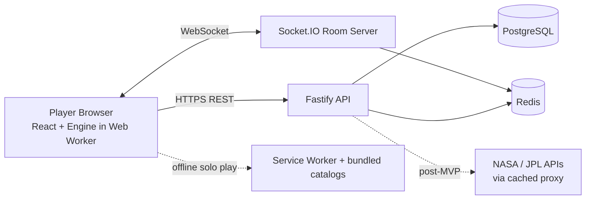

### 2.2.2 User roles

| Role | Available in | Owns / may edit | Notes |
| --- | --- | --- | --- |
| **Guest Player** (solo) | Solo | Everything | Default; no account |
| **Mission Architect** | Co-op | Objective/site, orbit, launch vehicle, mission timeline | Convenes the GO/NO-GO vote |
| **Spacecraft Engineer** | Co-op | Structure/bus, propulsion, attitude control, onboard computer | Owns the Δv and mass budget |
| **Science Lead** | Co-op | Instruments, observation plan | Owns science value and data volume |
| **Operations & Resources** | Co-op | Power (arrays, batteries), communications, budget | Owns power, downlink and cost margins |
| **Room Host** | Co-op | Create room, choose scenario/difficulty, start, kick | Also holds one gameplay role |
| **Registered Player** (optional) | Both | Save designs to profile, appear on leaderboard with a name | Opt-in |
| **Administrator** | Back office | Catalog publishing, leaderboard moderation | Internal |

With fewer than four players, unfilled roles are merged into existing players; in solo mode one player holds all four.

### 2.2.3 Operating environment

Modern evergreen browsers (Chrome, Edge, Firefox, Safari; latest two versions); desktop, tablet, phone. Server: Linux container, Node.js 22 LTS.

### 2.2.4 Design and implementation constraints

- TypeScript strict mode across all packages.
- The simulation engine MUST be pure and deterministic (no `Date.now()`, no unseeded `Math.random()`, no DOM access).
- All catalog values MUST carry a provenance label.

## 2.3 Specific Requirements — Functional

### 2.3.1 Scenario and mission definition (SRS-MIS)

| ID | Requirement | Priority |
| --- | --- | --- |
| SRS-MIS-01 | The system MUST present at least three scenarios at MVP: *CubeSat Earth Observer (LEO)*, *Lunar Orbiter*, *Mars Orbiter* (§0.8). | Must |
| SRS-MIS-02 | Each scenario MUST define: objective text, science goals (2–4, each with a weight), target body, allowed orbits, resource limits, mission-duration target, and difficulty modifiers. | Must |
| SRS-MIS-03 | The player MUST select a science goal set **before** component selection is unlocked. | Must |
| SRS-MIS-04 | Three difficulty tiers MUST exist: *Explorer* (wide margins, hints on), *Engineer* (standard), *Flight Director* (tight margins, more random events, hints off); margin targets follow §0.6.4. | Must |
| SRS-MIS-05 | A sandbox mode SHOULD allow unconstrained limits and any catalog item. | Should |

### 2.3.2 Spacecraft and payload design (SRS-DES)

| ID | Requirement | Priority |
| --- | --- | --- |
| SRS-DES-01 | The studio MUST offer these subsystem categories: structure/bus, power (solar array, battery), communications (antenna, transmitter), onboard computer, attitude control, propulsion, and instruments. | Must |
| SRS-DES-02 | Every catalog item MUST expose: mass (kg), power draw or generation (W), cost (M$), data rate generated (Mbit/day) where relevant, science value (points) where relevant, reliability (0–1), and an "advanced" flag. | Must |
| SRS-DES-03 | On *Explorer* difficulty only simple items are shown; *Engineer* and above show advanced items. | Must |
| SRS-DES-04 | Every add/remove/swap MUST update all six resource gauges within 100 ms. | Must |
| SRS-DES-05 | Each gauge MUST show used, limit, margin %, and a status (OK / Warning below the tier's margin target in §0.6.4 / Over limit). | Must |
| SRS-DES-06 | Each item MUST have a plain-language "why does this matter?" tooltip. | Must |
| SRS-DES-07 | A 2D (and optionally 3D) spacecraft view SHOULD reflect the chosen components. | Should |
| SRS-DES-08 | Undo/redo of at least 50 steps MUST be supported. | Should |

### 2.3.3 Launch and orbit (SRS-LOR)

| ID | Requirement | Priority |
| --- | --- | --- |
| SRS-LOR-01 | At least four launch vehicles MUST be selectable, each with payload capacity per orbit class, cost, and reliability. | Must |
| SRS-LOR-02 | At least four orbit options per scenario MUST be offered with a plain-language explanation of coverage, observation windows, communication windows and lifetime. | Must |
| SRS-LOR-03 | The system MUST run a **compatibility check**: total wet mass ≤ launch capacity for the selected orbit/trajectory, and required Δv ≤ available Δv. Failure MUST block launch and state the exact deficit (e.g. "Over by 42 kg"). | Must |
| SRS-LOR-04 | The system MUST show required vs. available Δv with the breakdown (transfer, insertion, station-keeping, margin). | Must |

### 2.3.4 Resource model (SRS-RES)

| ID | Requirement |
| --- | --- |
| SRS-RES-01 | **Mass**: sum of component dry mass + propellant mass + payload adapter; wet mass compared to launcher capacity. |
| SRS-RES-02 | **Power**: generation = array area × efficiency × solar flux at target distance (1/r²) × (1 − eclipse fraction for orbit); consumption = sum of active loads per mode; battery MUST cover eclipse. |
| SRS-RES-03 | **Budget**: development cost + launch cost + operations cost per day × duration; events MAY alter it. |
| SRS-RES-04 | **Data**: generated per day = sum of instrument rates × duty cycle; onboard recorder has finite capacity. |
| SRS-RES-05 | **Communications**: downlink per day = data rate(antenna gain, transmit power, distance) × contact time per orbit × contacts per day; data generated beyond downlink + buffer is lost. |
| SRS-RES-06 | **Time**: development schedule + transit + operations; launch windows constrain start. |
| SRS-RES-07 | The scenario view MUST highlight the **critical resource(s)** for the chosen scenario (e.g. communications for Mars). |
| SRS-RES-08 | All formulas MUST live in the engine package and be documented with a provenance label per constant. |

### 2.3.5 Mission simulation (SRS-SIM)

| ID | Requirement | Priority |
| --- | --- | --- |
| SRS-SIM-01 | The simulation MUST advance through phases: **Development → Launch → Transfer/Cruise → Orbit Insertion → Science Operations → End of Life**. | Must |
| SRS-SIM-02 | Time step MUST be one simulated day during cruise/operations and finer during launch and insertion. | Must |
| SRS-SIM-03 | Given identical design, scenario, difficulty and seed, the result MUST be bit-for-bit identical. | Must |
| SRS-SIM-04 | The simulator MUST support at least six random event types: solar particle event, reaction-wheel failure, launch slip, budget cut, antenna pointing anomaly, battery degradation. Each event's effect MUST be mitigated or worsened by specific design choices (e.g. shielded computer, spare wheel, battery margin). | Must |
| SRS-SIM-05 | A live dashboard MUST show mission clock, phase, power, battery state, data buffer, cumulative science points, and active events. | Must |
| SRS-SIM-06 | The player MUST be able to pause, change speed (1×, 5×, 20×), and skip to the end. | Should |
| SRS-SIM-07 | One decision point MUST appear in each run in which the player chooses between competing options (e.g. spend fuel for an extra observation vs. keep margin). | Should |
| SRS-SIM-08 | A full run MUST complete in under 500 ms of compute (excluding animation). | Must |

### 2.3.6 Scoring and report (SRS-SCR)

| ID | Requirement |
| --- | --- |
| SRS-SCR-01 | The score MUST be 0–100 composed of: **Mission performance 30**, **Science value 25**, **Resource efficiency 15**, **Decision quality 15**, **Team collaboration 15**. In solo mode the collaboration weight is redistributed proportionally across the other four. |
| SRS-SCR-02 | Difficulty MUST apply a multiplier shown to the player (Explorer ×1.0, Engineer ×1.15, Flight Director ×1.3), capped at 100 on the display with the raw score retained. |
| SRS-SCR-03 | Mission outcome MUST be one of: Full Success, Partial Success, Failure (with failure phase). |
| SRS-SCR-04 | The report MUST include: timeline with events, resource usage vs. limits, score breakdown, and **at least 3 causal statements** of the form "Because you chose X, Y happened, which reduced Z by N." |
| SRS-SCR-05 | The report MUST include "Try changing…" suggestions that point to specific design fields and pre-fill a new design variant. |
| SRS-SCR-06 | No single "perfect solution": scoring MUST be validated so that at least three materially different designs reach ≥ 85 on each MVP scenario (tested by automated search). |

### 2.3.7 Collaboration (SRS-COL)

| ID | Requirement | Priority |
| --- | --- | --- |
| SRS-COL-01 | A host MUST be able to create a room and share a 6-character join code; 2–4 players join. | Must |
| SRS-COL-02 | Roles MUST be assignable and swappable before launch; edits outside a player's role MUST be rejected by the server. | Must |
| SRS-COL-03 | A player MAY send a **proposal** to change a subsystem they do not own; the owner can accept or reject it. | Must |
| SRS-COL-04 | Launch MUST require a **GO from every player** in a GO/NO-GO poll; any NO-GO MUST include a reason. | Must |
| SRS-COL-05 | All players MUST see the same design state within 300 ms (p95) of a change. | Must |
| SRS-COL-06 | A disconnected player MUST be able to rejoin and resume within 2 minutes; otherwise the host can reassign the role. | Should |
| SRS-COL-07 | Competitive mode MAY run two teams on the same scenario with the same seed and compare scores. | Could |

### 2.3.8 Persistence and sharing (SRS-SAV)

| ID | Requirement |
| --- | --- |
| SRS-SAV-01 | Designs MUST autosave locally (IndexedDB) every change in solo mode. |
| SRS-SAV-02 | A design MUST be exportable as a **design code** (compressed, URL-safe string) and importable via URL or paste. |
| SRS-SAV-03 | Registered users MAY save designs to their profile and compare two designs side by side. |
| SRS-SAV-04 | Each scenario/difficulty MUST have a leaderboard (top 50) showing score, team name, role count, design code. |

### 2.3.9 Education (SRS-EDU)

| ID | Requirement |
| --- | --- |
| SRS-EDU-01 | A guided tutorial mission MUST introduce concepts in order: objective → mass → power → launch → orbit → data/comms. |
| SRS-EDU-02 | A glossary MUST be reachable from any screen; terms in the UI are linked to it. |
| SRS-EDU-03 | Every warning MUST explain **why** it matters and **how** to fix it. |
| SRS-EDU-04 | A static facts panel SHOULD show bundled, source-labeled facts (e.g. planetary distance, solar flux, mission analogs) with links to the source. Live NASA feeds are Future scope. |

## 2.4 Non-Functional Requirements

### 2.4.1 Performance (SRS-PERF)

| ID | Requirement |
| --- | --- |
| SRS-PERF-01 | Largest Contentful Paint ≤ 2.5 s on a simulated 4G, mid-range phone. |
| SRS-PERF-02 | Critical-path JS ≤ 400 KB gzipped; 3D code lazy-loaded. |
| SRS-PERF-03 | UI interaction latency (gauge update) ≤ 100 ms p95. |
| SRS-PERF-04 | Multiplayer state propagation ≤ 300 ms p95 within one region. |
| SRS-PERF-05 | Server supports 500 concurrent rooms (2,000 sockets) per instance on the chosen tier. |

### 2.4.2 Reliability, availability, scalability (SRS-REL)

| ID | Requirement |
| --- | --- |
| SRS-REL-01 | Solo mode MUST work with no backend after first load (service worker). |
| SRS-REL-02 | Backend availability target 99.5% monthly. |
| SRS-REL-03 | The server MUST recover room state from Redis after a restart within 30 s; rooms idle > 30 min are discarded. |
| SRS-REL-04 | The API MUST be stateless and horizontally scalable; Socket.IO MUST use the Redis adapter to scale across instances. |

### 2.4.3 Maintainability and portability (SRS-MNT)

| ID | Requirement |
| --- | --- |
| SRS-MNT-01 | Monorepo with isolated packages; engine has ≥ 80% unit-test coverage. |
| SRS-MNT-02 | Catalogs are JSON validated by Zod schemas in CI; adding a part requires no code change. |
| SRS-MNT-03 | Lint, type-check, test and build MUST pass in CI before merge. |
| SRS-MNT-04 | The app MUST be deployable from a single Docker image (server) and a static bundle (client). |

## 2.5 Security Requirements

### 2.5.1 Authentication (SRS-AUTH)

- **Guest session (default):** server issues a signed JWT (15-minute access token + 30-day refresh cookie, `HttpOnly`, `Secure`, `SameSite=Lax`) with a random `guestId`; no personal data collected.
- **Optional registration:** OAuth 2.0 / OIDC sign-in (Google, GitHub) via an established library; guest history can be linked on sign-in.
- Solo mode requires no authentication.

### 2.5.2 Authorization (SRS-AUTHZ)

| Resource | Guest | Registered | Room member | Admin |
| --- | --- | --- | --- | --- |
| Play solo, run simulation | ✓ | ✓ | ✓ | ✓ |
| Create/join room | ✓ | ✓ | — | ✓ |
| Edit subsystem in room | — | — | Only own role (server-enforced) | — |
| Save design to profile | — | ✓ | — | ✓ |
| Submit leaderboard score | ✓ (anonymous name) | ✓ | ✓ | ✓ |
| Publish catalogs / moderate | — | — | — | ✓ |

### 2.5.3 Data protection and abuse prevention (SRS-SEC)

- All traffic over TLS 1.2+; HSTS enabled; strict Content-Security-Policy.
- Zod validation on every REST body and every socket message; reject unknown fields.
- Rate limiting: 60 requests/min/IP on REST, 20 socket events/s/connection, 5 room creations/hour/guest.
- Leaderboard scores MUST be **recomputed server-side** from the submitted design + seed; client-reported scores are never trusted.
- Team and display names pass a profanity filter; no free-text chat in MVP (preset messages only) to protect young users.
- No personal data stored for guests; analytics anonymized; no ads.
- Secrets in the platform secret store; none in the repository. Dependency scanning (Dependabot, `npm audit`) in CI.

## 2.6 Database Requirements (SRS-DB)

| ID | Requirement |
| --- | --- |
| SRS-DB-01 | PostgreSQL 16; schema managed by versioned migrations. |
| SRS-DB-02 | Entities: `users`, `designs`, `design_versions`, `runs`, `scores`, `rooms`, `room_members`, `proposals`, `catalog_versions`, `audit_events` (ER detail in Document 3). |
| SRS-DB-03 | Design documents stored as JSONB with a `schema_version` field; migration functions upgrade old designs on load. |
| SRS-DB-04 | Indexes on `(scenario_id, difficulty, score DESC)` for leaderboards and on `(owner_id, updated_at DESC)` for profiles. |
| SRS-DB-05 | Soft delete for user-owned designs; hard delete of guest data after 90 days of inactivity. |

## 2.7 API Requirements (SRS-API)

REST over HTTPS, JSON, versioned under `/api/v1`, documented with OpenAPI 3.1. Real-time over Socket.IO.

| Method & path | Purpose | Auth |
| --- | --- | --- |
| `POST /auth/guest` | Create guest session | None |
| `GET /catalogs/:version` | Fetch parts, vehicles, orbits, scenarios | None (cacheable) |
| `POST /designs` / `GET /designs/:id` / `PUT /designs/:id` | Save and load designs | Registered |
| `POST /simulate` | Run the engine server-side for validation | Guest+ |
| `POST /scores` | Submit run for leaderboard (server recomputes) | Guest+ |
| `GET /leaderboards/:scenario?difficulty=` | Top scores | None |
| `POST /rooms` / `POST /rooms/:code/join` | Create/join room | Guest+ |
| `GET /nasa/*` | Cached proxy for NASA/JPL data (post-MVP) | None |
| `GET /healthz`, `GET /readyz` | Liveness / readiness | None |

**Socket events (client→server):** `room:join`, `role:claim`, `design:patch`, `proposal:create`, `proposal:respond`, `vote:cast`, `sim:start`. **Server→client:** `room:state`, `design:applied`, `design:rejected`, `proposal:update`, `vote:update`, `sim:tick`, `sim:result`.

Errors use RFC 9457 Problem Details (`type`, `title`, `status`, `detail`, `instance`).

## 2.8 Third-Party Integrations and External Interfaces

| Integration | Use | Fallback |
| --- | --- | --- |
| NASA Open APIs (APOD, NeoWs, DONKI) via `api.nasa.gov` (post-MVP) | Daily image, near-Earth objects, solar-activity context in the live data panel | Bundled sample data; label "offline sample" |
| JPL Horizons / planetary data | Body distances and positions for transfer estimates | Bundled ephemeris table |
| NASA Image and Video Library | Destination imagery in mission briefs | Bundled public-domain images |
| GMAT (offline, not a runtime dependency) | Δv budgets, transfer times, trajectory samples exported to JSON labeled `NASA/GMAT` | Analytical values labeled `DERIVED` |
| OAuth providers (Google, GitHub) | Optional sign-in | Guest mode |
| Sentry, Better Stack, PostHog | Errors, logs/metrics, analytics | App continues without them |

**External interfaces:** *User interface* — responsive layout, keyboard navigable, high-contrast and reduced-motion themes. *Hardware* — none. *Software* — browser APIs: WebSocket, Web Workers, IndexedDB, Service Worker, Canvas/WebGL (optional). *Communications* — HTTPS (443), WSS.

## 2.9 Error Handling (SRS-ERR)

- Client: a top-level error boundary shows a friendly screen with "Reload" and "Restore last design"; designs are never lost because of autosave.
- Engine: invalid design input returns a typed `ValidationResult` listing every problem; it never throws into the UI.
- Network: API calls retry with exponential backoff (max 3); socket reconnects automatically and requests a full `room:state` snapshot.
- Server: all errors mapped to Problem Details; unexpected errors return a generic message and a correlation ID; stack traces are never exposed.

## 2.10 Logging, Monitoring, Backup (SRS-OPS)

| Area | Requirement |
| --- | --- |
| Logging | Structured JSON logs (pino) with `requestId`, `roomId`, `guestId` hash; log levels by environment; no PII; 30-day retention |
| Monitoring | Health endpoints; metrics: request rate/latency, active rooms, socket count, sim duration, error rate; alert if error rate > 2% for 5 min or p95 latency > 800 ms |
| Frontend monitoring | Sentry with source maps; Web Vitals reported to PostHog |
| Backup | Managed PostgreSQL point-in-time recovery (7 days) plus a nightly logical dump to object storage kept 30 days; Redis treated as ephemeral; catalogs also versioned in Git |
| Restore test | Restore drill performed once before public launch |

## 2.11 Compliance (SRS-CMP)

- **Accessibility:** WCAG 2.2 AA; keyboard operability, screen-reader labels, 4.5:1 contrast, `prefers-reduced-motion`, color-blind-safe palette, no color-only status.
- **Privacy:** data minimization; cookie banner only if non-essential cookies are used; child-friendly design (target audience includes minors) with COPPA/GDPR-K principles — no collection of personal data from guests.
- **NASA branding and media:** no implication of endorsement; follow NASA media usage guidelines; display the disclaimer "Independent project created for the NASA Space Apps Challenge; not a NASA product."
- **Licensing:** open-source license for code (MIT); data attributions listed on an About page.
- **Scientific honesty:** every number has a provenance label (NASA / DERIVED / GAME).

## 2.12 Testing Requirements (SRS-TST)

| Level | Scope | Tool | Gate |
| --- | --- | --- | --- |
| Unit | Engine formulas, scoring, validation, catalog schemas | Vitest | ≥ 80% coverage on engine |
| Property-based | Determinism, resource monotonicity, no NaN | fast-check | Pass in CI |
| Component | Studio, gauges, tutorials | Testing Library | Pass in CI |
| Integration | REST + DB, socket room flow with 4 simulated clients | Vitest + Testcontainers | Pass in CI |
| End-to-end | Tutorial completion, solo run, 4-player run with GO/NO-GO | Playwright | Pass on main |
| Accessibility | Automated + manual screen-reader pass | axe-core, NVDA/VoiceOver | 0 critical issues |
| Performance | Lighthouse CI, load test of 500 rooms | Lighthouse, k6 | Meets SRS-PERF |
| Balance | Automated search proves multiple viable designs per scenario | Custom script | SRS-SCR-06 |
| Usability | 5+ playtests with beginners | Observation | ≥ 70% finish in 10 min |

## 2.13 Deployment Requirements (SRS-DEP)

- Environments: **local** (Docker Compose), **preview** (per pull request), **staging**, **production**.
- Client deployed as a static bundle on Vercel with immutable, hashed assets; server deployed as a Docker image on Fly.io (min 2 instances in production, health-checked).
- Zero-downtime deploys (rolling); database migrations run before the new version receives traffic and are backward compatible for one release.
- Configuration by environment variables validated at boot; the server refuses to start with missing secrets.
- Rollback: redeploy the previous image or Vercel deployment within 5 minutes.

---

# Document 3 — System Design Document

## 3.1 Architecture Principles

1. **Engine first.** All game rules live in one pure, deterministic TypeScript package. UI and server are thin shells around it.
2. **Local-first solo, authoritative co-op.** Solo needs no server. Co-op validates every change on the server with the same engine.
3. **Data-driven.** Parts, vehicles, orbits and scenarios are JSON catalogs with provenance labels, so the Resources-tab data can be dropped in without code changes.
4. **Modular monolith, not microservices.** One deployable server with clean module boundaries; extract only if load demands it.
5. **Explain everything.** Every engine output carries the reasons (inputs, formula, contributing choices) needed for the causal report.

## 3.2 High-Level Architecture

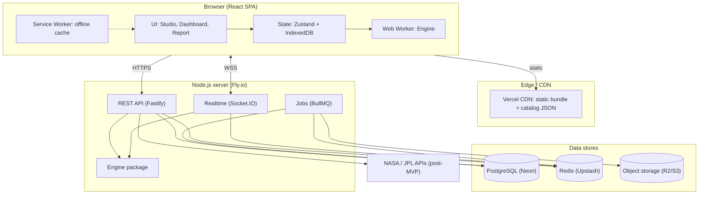

## 3.3 Low-Level Architecture — the Simulation Engine

The engine is the heart of the product. It exposes four pure functions:

| Function | Input | Output |
| --- | --- | --- |
| `validate(design, scenario, catalog)` | Design JSON | `ValidationResult`: list of issues (error / warning / info), each with `why` and `fix` text |
| `computeBudgets(design, scenario, catalog)` | Design JSON | Six resource gauges with used / limit / margin / status and the contributing items |
| `simulate(design, scenario, catalog, seed, difficulty)` | Design + seed | `RunResult`: timeline of states, events, outcome, final metrics, `trace` of causal records |
| `score(runResult, scenario, teamInfo)` | RunResult | Score breakdown, outcome class, causal statements, "try changing" suggestions |

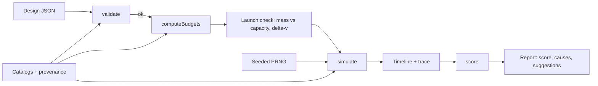

### 3.3.1 Core models (all constants carry a provenance label)

| Domain | Model | Notes |
| --- | --- | --- |
| Delta-v from propellant | Δv = Isp × g₀ × ln(m₀ / m₁) (Tsiolkovsky) | `DERIVED` from standard physics; g₀ = 9.80665 m/s² |
| Required Δv | Table per scenario/orbit: ascent, transfer, insertion, station-keeping, margin | Values `NASA`/`DERIVED` where the Resources tab or standard mission-design references provide them; otherwise `GAME` |
| Orbital period | T = 2π√(a³/μ) | `DERIVED` |
| Solar flux | S = 1361 W/m² ÷ r² (r in AU) | `NASA`/`DERIVED`; about 590 W/m² at Mars |
| Eclipse fraction | Lookup per orbit type (e.g. LEO about 35%, SSO dawn-dusk near 0%) | `GAME` simplification |
| Power balance | Generation − mode load; battery charge/discharge per step with depth-of-discharge limit | `GAME` |
| Communications | Daily downlink ∝ (P\_tx × G²) ÷ d² × contact time (simplified link budget) | `GAME` calibrated against typical LEO vs. deep-space ranges |
| Light-time delay | d ÷ c, shown to teach latency | `DERIVED` |
| Reliability | Per-component daily failure hazard from catalog reliability; shielding and redundancy modify it | `GAME` |
| Cost | Sum of component costs + launch + (ops cost/day × days) | `GAME` |

### 3.3.2 Simulation loop (pseudo-code)

```text
state = initialState(design)
rng   = mulberry32(seed)
for phase in [DEVELOPMENT, LAUNCH, TRANSFER, INSERTION, SCIENCE_OPS, END_OF_LIFE]:
  for step in phase.steps(dt):
    events = rollEvents(phase, difficulty, rng)        // deterministic
    state  = applyEvents(state, events, design)         // design choices mitigate / worsen
    state  = updatePower(state); state = updateData(state); state = updateBudget(state)
    state  = checkFailureConditions(state)              // e.g. battery empty, Δv exhausted
    trace.push({ step, state, events, causes })        // causal record
    if state.terminal: break
outcome = classify(state, scenario.goals)
return { timeline, outcome, trace }
```

### 3.3.3 Scoring (weights from SRS-SCR-01)

| Component | Weight | Computed from |
| --- | --- | --- |
| Mission performance | 30 | Fraction of mission phases completed and science goals met |
| Science value | 25 | Σ (instrument value × data actually returned × goal weight), normalized to the scenario's maximum achievable |
| Resource efficiency | 15 | Margin use: reward 10–30% margin on each resource; penalize both over-limit and gross over-design (> 60% unused) |
| Decision quality | 15 | Mitigation choices vs. events encountered, decision-point outcome, absence of avoidable failures |
| Team collaboration | 15 | Co-op only: proposals resolved, balanced role contributions, time-to-consensus, no NO-GO caused by unresolved conflict |

Difficulty multiplier applied last (SRS-SCR-02).

### 3.3.4 Causal trace and report generation

Each resource change records `{ resource, delta, causedBy: [designItemId | eventId | formulaId], phase, step }`. The report builder aggregates the largest negative contributors on the final outcome and renders templates such as: *"Because the high-resolution camera produces 4× more data than your antenna can downlink, 38% of data was lost, reducing Science value by 9 points."* No free-form AI text is needed for correctness.

## 3.4 Component Diagram (Frontend)

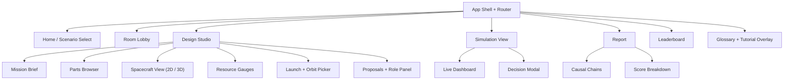

## 3.5 Data Flow

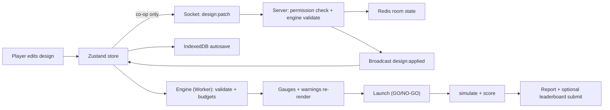

## 3.6 Request Flows

### 3.6.1 Co-op design change

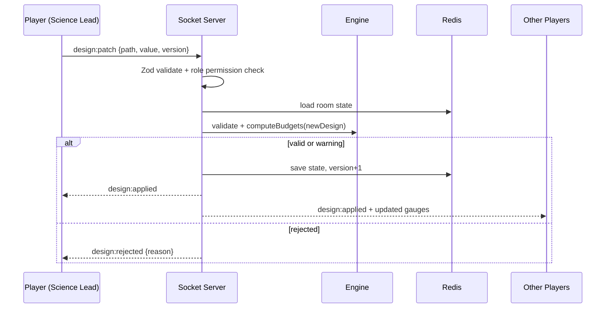

### 3.6.2 Leaderboard submission (server recomputes score)

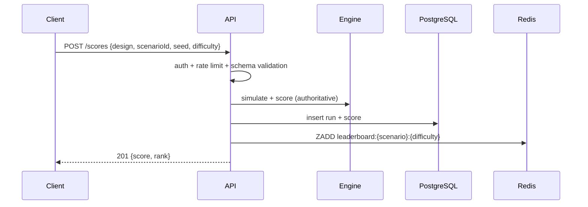

## 3.7 Module Breakdown

| Package / module | Responsibility |
| --- | --- |
| `packages/engine` | Validation, budgets, simulation, scoring, report builder, PRNG |
| `packages/catalog` | JSON catalogs, Zod schemas, provenance labels, version manifest |
| `packages/shared` | Types, Zod message schemas for REST/socket, design-code codec |
| `apps/web` | React app: UI, state, worker wrapper, service worker, i18n |
| `apps/server` | Fastify routes, Socket.IO rooms, auth, persistence, jobs |
| `apps/server/modules/rooms` | Room lifecycle, roles, proposals, votes |
| `apps/server/modules/scores` | Recompute, leaderboard, anti-cheat |
| `apps/server/modules/nasa` | Cached proxy, fallbacks, attribution (post-MVP) |
| `tools/balance` | Automated design-space search proving multiple viable designs |

### 3.7.1 Illustrative catalog content (no datasets in the resources; values stay `GAME`/`DERIVED` until sourced)

| Category | Entries (MVP) | Provenance |
| --- | --- | --- |
| Launch vehicles (archetypes) | Small-lift, Medium-lift, Heavy-lift, Super-heavy-lift with payload capacity per orbit class, cost, reliability | Capacities `GAME`, scaled from public vehicle class figures; replace with NASA/agency data when confirmed |
| Orbits | LEO, SSO, GEO, lunar low orbit, Mars low orbit, Mars elliptical | Periods `DERIVED`, eclipse/coverage `GAME` |
| Instruments | Visible camera, multispectral imager, spectrometer, radar sounder, magnetometer, radiation monitor | Mass/power ranges `GAME`, informed by public mission fact sheets |
| Subsystems | Bus sizes S/M/L, solar arrays, batteries, antennas (low/medium/high gain), computers (standard, radiation-hardened), wheels, thrusters (chemical/electric) | `GAME` |

## 3.8 Database Design

### 3.8.1 ER Diagram

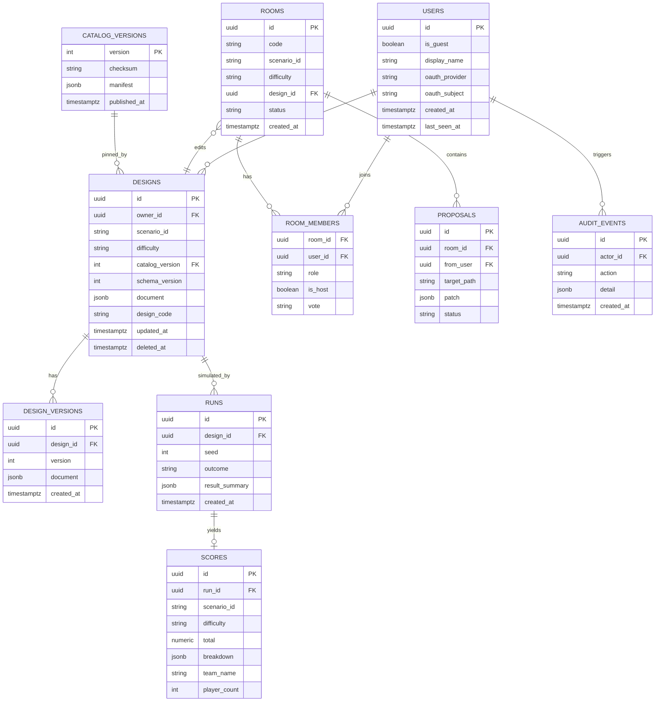

### 3.8.2 Design decisions

- **JSONB for the design document** keeps the schema flexible while scenarios evolve; `schema_version` plus migration functions protect old designs.
- **Rooms are live in Redis**; Postgres stores the final snapshot when the room ends.
- **Indexes:** `scores(scenario_id, difficulty, total DESC)`, `designs(owner_id, updated_at DESC)`, `rooms(code)` unique.
- **Retention:** guest data purged after 90 days of inactivity; runs older than 180 days summarized.

## 3.9 API Architecture

- REST for request/response (catalogs, saves, scores, rooms); Socket.IO for room state. Both defined with shared Zod schemas from `packages/shared`, so client and server cannot drift.
- OpenAPI 3.1 generated from the Zod schemas (`zod-to-openapi`); versioned `/api/v1`.
- Idempotency keys on `POST /scores` and `POST /rooms` to survive client retries.
- Optimistic concurrency in rooms: each `design:patch` carries the version it was based on; conflicts return the latest state and the client rebases.

## 3.10 Authentication Flow

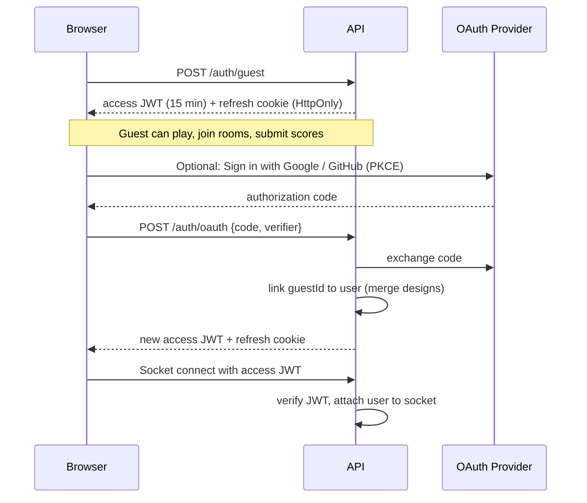

## 3.11 Authorization Flow

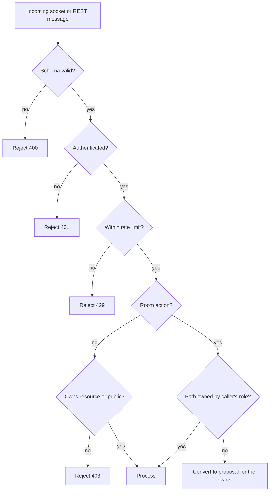

## 3.12 AI Pipeline (optional, post-MVP “Mission Mentor”)

The MVP needs **no AI**: correctness and scientific honesty come from the deterministic engine and templated explanations. An optional coach can be added later:

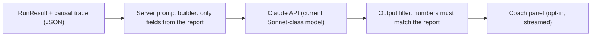

Guardrails: API key only on the server; per-guest rate limit and daily cap; prompt includes only the report JSON, never player-typed text; responses cached per run hash; the UI clearly labels the content as AI-generated. Use the current model identifier from Anthropic's documentation when implementing.

## 3.13 Blockchain Architecture

Not applicable. No on-chain component is required or recommended.

## 3.14 Cloud Architecture

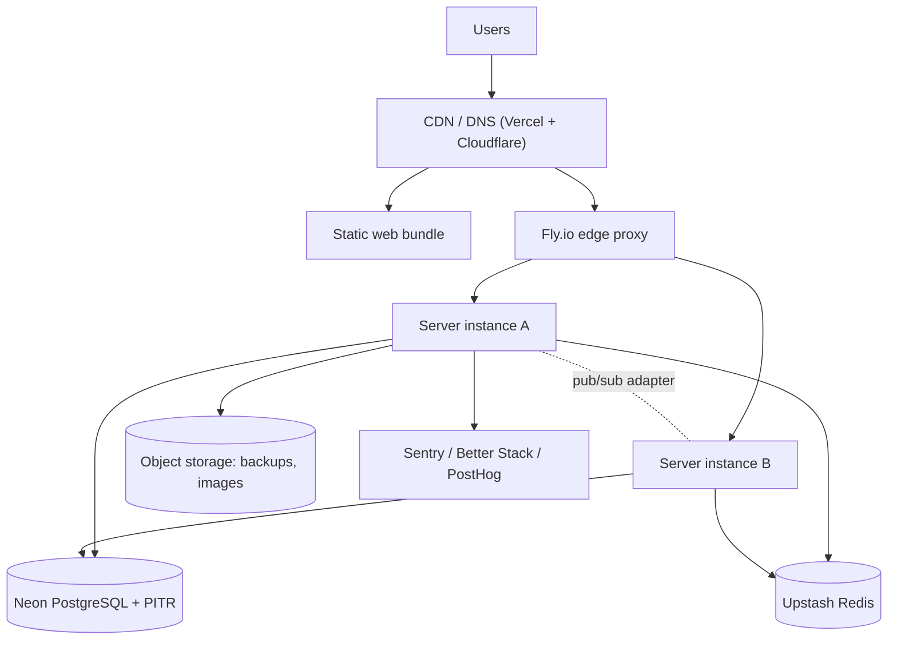

**Why this platform:** all components have free or low-cost tiers, require no cluster management, and fit a hackathon timeline. **Alternatives:** AWS (ECS Fargate + RDS + ElastiCache) for stricter enterprise needs — more setup and cost; Cloudflare Workers + Durable Objects for rooms — elegant for realtime but a different programming model.

## 3.15 Storage Architecture

| Data | Store | Notes |
| --- | --- | --- |
| Designs, runs, scores, users | PostgreSQL | Source of truth |
| Live room state, votes, presence | Redis (JSON, TTL 30 min idle) | Ephemeral; snapshot to Postgres at room end |
| Leaderboards | Redis sorted sets, mirrored in Postgres | Rebuildable from `scores` |
| Catalogs | Git + versioned JSON on CDN | Immutable URLs `/catalog/v{n}.json` |
| Images, 3D models | CDN (compressed WebP, glTF with Draco) | Public-domain or NASA-licensed only |
| Backups | Object storage | Nightly dump, 30-day retention |
| Local solo state | IndexedDB (Dexie) | Autosave, undo history |

## 3.16 Caching Strategy

| Layer | What | Policy |
| --- | --- | --- |
| Browser / service worker | App shell, catalogs, glossary | Cache-first with versioned URLs; stale-while-revalidate for NASA panel |
| CDN | Static assets, catalog JSON | Immutable, 1 year, hashed filenames |
| Redis | NASA/JPL responses | TTL 6 h; serve stale on upstream error |
| Redis | Leaderboard pages | TTL 30 s or invalidate on write |
| In-process LRU | `simulate` results | Key = hash(design, seed, difficulty, catalogVersion); deterministic, so safe |

## 3.17 Queue Architecture

BullMQ on Redis, running inside the server process at MVP (separate worker process later).

| Queue | Job | Trigger |
| --- | --- | --- |
| `scores` | Recompute and persist score, update leaderboard | Score submission (if sim exceeds budget) |
| `nasa-refresh` (post-MVP) | Refresh cached NASA datasets | Cron every 6 h |
| `housekeeping` | Purge idle guests and old rooms | Nightly |
| `backup` | Logical dump to object storage | Nightly |

Retries: 3 attempts, exponential backoff; failed jobs go to a dead-letter set surfaced in monitoring.

## 3.18 Microservices

**Decision: modular monolith.** Splitting a hackathon-scale app into services adds network hops, deployment complexity and failure modes with no benefit. **Future extraction candidates:** `sim-worker` (if server-side simulation becomes CPU-bound), `realtime-gateway` (if sockets outgrow API scaling). Module boundaries in §3.7 make this a refactor, not a rewrite.

## 3.19 CI/CD Pipeline

```mermaid
flowchart LR
  PR["Pull request"] --> L["Lint + typecheck"]
  L --> UT["Unit + property tests"]
  UT --> CAT["Catalog schema validation"]
  CAT --> BLD["Build web + server image"]
  BLD --> PV["Preview deploy (Vercel + Fly review app)"]
  PV --> E2E["Playwright E2E + axe"]
  E2E --> LH["Lighthouse CI"]
  LH --> MG{"Merge to main"}
  MG --> STG["Deploy staging"]
  STG --> SMK["Smoke tests"]
  SMK --> PRD["Manual approval, deploy production (rolling)"]
  PRD --> POST["Post-deploy health check, auto rollback on failure"]
```

Tools: GitHub Actions, pnpm + Turborepo caching, Docker, Dependabot, CodeQL.

## 3.20 Monitoring

| Signal | Tool | Alert |
| --- | --- | --- |
| Frontend errors, performance | Sentry, Web Vitals to PostHog | New error spike; LCP regression |
| API latency and error rate | Better Stack / Grafana (OpenTelemetry metrics) | Error rate > 2% for 5 min; p95 > 800 ms |
| Realtime health | Custom metrics: active rooms, sockets, patch latency | p95 patch latency > 500 ms |
| Simulation duration | Histogram | p95 > 500 ms |
| Infrastructure | Fly.io metrics, Neon and Upstash dashboards | CPU > 80% for 10 min; DB connections > 80% |
| Uptime | External probe on `/healthz` and a synthetic 2-player room | 2 failures in a row |

## 3.21 Logging

- pino JSON logs; fields: `ts`, `level`, `requestId`, `roomId`, `route`, `latencyMs`, `guestHash` (never the raw ID or any IP).
- Levels: `debug` locally, `info` in production, `warn`/`error` page on-call channel.
- Correlation IDs flow from client (header) through socket events to logs and Sentry.
- Shipped to Better Stack; 30-day retention.

## 3.22 Security Architecture

| Threat | Control |
| --- | --- |
| Cheating on leaderboard | Server recomputes every score from design + seed |
| Role bypass in rooms | Server-side path ownership check on every patch |
| Injection / malformed input | Zod on all input; parameterized queries via Drizzle; reject unknown keys |
| XSS | React escaping, strict CSP (no inline scripts), sanitized names, no free-text chat |
| CSRF | Bearer tokens for API; `SameSite=Lax` refresh cookie scoped to `/auth` |
| Abuse / DoS | Per-IP and per-guest rate limits, room caps, socket event throttling, Cloudflare WAF |
| Secrets leakage | Platform secret store, `.env` ignored, secret scanning in CI |
| Supply chain | Lockfile, Dependabot, CodeQL, only pinned versions |
| Child safety | No personal data from guests, preset messages only, moderated display names |

## 3.23 Folder Structure

```text
gravity/
├── apps/
│   ├── web/
│   │   ├── src/
│   │   │   ├── app/            # router, providers, error boundary
│   │   │   ├── features/
│   │   │   │   ├── scenarios/  # scenario select, mission brief
│   │   │   │   ├── studio/     # parts browser, gauges, craft view
│   │   │   │   ├── launch/     # launch + orbit picker, compatibility
│   │   │   │   ├── simulation/ # dashboard, decision modal, worker client
│   │   │   │   ├── report/     # score, causal chains, suggestions
│   │   │   │   ├── rooms/      # lobby, roles, proposals, GO/NO-GO
│   │   │   │   ├── leaderboard/
│   │   │   │   ├── requirements/ # STM, requirements + verification, MEL
│   │   │   │   ├── readiness/  # G/Y/R checklist, 5×5 risk matrix
│   │   │   │   ├── trade-space/ # trade-space chart, sensitivity
│   │   │   │   ├── replay/     # 2D/3D mission replay
│   │   │   │   └── education/  # tutorial, glossary, static facts panel
│   │   │   ├── components/     # shared UI (Radix-based)
│   │   │   ├── store/          # Zustand slices, IndexedDB persistence
│   │   │   ├── workers/        # engine.worker.ts
│   │   │   ├── i18n/
│   │   │   └── styles/
│   │   ├── public/             # icons, manifest, 3D assets
│   │   └── e2e/                # Playwright tests
│   └── server/
│       ├── src/
│       │   ├── main.ts
│       │   ├── plugins/        # auth, rate-limit, cors, sentry
│       │   ├── modules/        # auth, designs, scores, rooms, nasa, catalogs
│       │   ├── realtime/       # socket gateway, handlers
│       │   ├── jobs/           # BullMQ workers
│       │   └── db/             # drizzle schema, migrations
│       └── Dockerfile
├── packages/
│   ├── engine/                 # validate, budgets, simulate, score, report, prng
│   ├── catalog/                # json + zod schemas + provenance
│   └── shared/                 # types, message schemas, design-code codec
├── tools/balance/              # design-space search
├── tools/gmat/                 # GMAT scripts and export notes
├── docs/                       # architecture, data-provenance ledger, playtest notes
├── .github/workflows/
├── docker-compose.yml
├── turbo.json
└── pnpm-workspace.yaml
```

## 3.24 Technology Stack Summary

See the table in §0.3. Additional libraries: **Drizzle ORM**, **Zod**, **pino**, **BullMQ**, **Dexie** (IndexedDB), **Vite PWA plugin**, **Radix UI**, **Framer Motion** (respecting reduced-motion), **fast-check**, **Testing Library**, **axe-core**, **k6**, **i18next**.

## 3.25 Design Patterns

| Pattern | Where |
| --- | --- |
| Pure functional core, imperative shell | Engine vs. UI/server |
| Command + event log | `design:patch` ops give undo/redo, sync and audit trail |
| Strategy | Scenario-specific scoring modifiers, orbit models |
| Observer / pub-sub | Socket rooms, Redis adapter |
| Repository | Persistence behind interfaces so modules are testable |
| State machine | Room lifecycle (lobby → design → vote → simulating → report) and simulation phases (XState or a small custom FSM) |
| Adapter | NASA/JPL clients with uniform fallback behavior |
| Feature flags | Gate 3D view, AI coach, competitive mode |

## 3.26 Scalability Strategy

- **Client does the work in solo mode**, so most traffic never touches the server.
- Stateless API behind a load balancer; Socket.IO with the Redis adapter for multi-instance rooms; sticky sessions not required.
- Scale triggers: > 70% CPU or > 1,500 sockets per instance → add instances. Large events (classrooms): pre-warm instances.
- Hot reads (leaderboards, catalogs) served from CDN and Redis. DB connection pooling via Neon's pooler.
- Capacity target: 500 concurrent rooms per instance (SRS-PERF-05).

## 3.27 Fault Tolerance

| Failure | Behavior |
| --- | --- |
| Backend down | Solo play continues offline; co-op shows a clear "reconnecting" state |
| Socket drop | Auto-reconnect, full `room:state` resync, 2-minute grace for role |
| Redis unavailable | Rooms degrade to in-memory on the instance with a warning; leaderboards served from Postgres |
| Database unavailable | Read-only mode for catalogs; score submission queued client-side and retried |
| NASA API down or rate limited | Serve stale cache, then bundled sample data labeled as offline |
| Bad deploy | Health check fails, automatic rollback to previous release |
| Client crash | Error boundary + IndexedDB autosave restore |

## 3.28 Disaster Recovery

| Item | Target |
| --- | --- |
| RPO (data loss tolerance) | ≤ 24 h for scores and profiles (PITR reduces to minutes); room state is disposable |
| RTO (time to restore) | ≤ 2 h |
| Backups | Neon PITR 7 days + nightly dump to object storage, 30-day retention; catalogs in Git |
| Runbook | Restore DB from latest snapshot → redeploy last known-good image → warm Redis (leaderboards rebuilt from `scores`) → smoke test → announce |
| Drills | One restore drill before public launch, then quarterly |

---

# Document 4 — Implementation Plan

## 4.1 How to Use This Plan

The event runs **Nov 14–15, 2026**, so the plan has two tracks:

- **Track A — Hackathon sprint (T+0 to T+48 h):** ships the MVP from the PRD. **T+0 = your team's kickoff**; shift the times to match your local event. If you are already hours in, jump to the **cut lines in §4.4** and keep the phase order.
- **Track B — Production path (after the event):** hardens the project into a production-quality release over about 8 weeks.

**Estimates assume a team of 4–5.** Hours are effort per phase on the critical path unless noted; phases overlap as shown in the timeline.

## 4.2 Hackathon Timeline

```mermaid
gantt
  title Track A - Hackathon sprint (T+0 = Sat 14 Nov 09:00; shift to your kickoff)
  dateFormat YYYY-MM-DD HH:mm
  axisFormat %a %H:%M
  section Setup
  P0 Kickoff, scope lock, repo, accounts      :p0, 2026-11-14 09:00, 2h
  P1 Foundation (monorepo, CI, shell, deploy) :p1, after p0, 4h
  section Core
  P2 Engine: models, validate, budgets        :p2, 2026-11-14 11:00, 8h
  P3 Studio UI + gauges + launch/orbit        :p3, 2026-11-14 15:00, 10h
  P4 Simulation, dashboard, scoring, report   :p4, 2026-11-14 23:00, 9h
  section Multiplayer
  P5 Co-op rooms, roles, GO/NO-GO             :p5, 2026-11-15 06:00, 8h
  section Finish
  P6 Education, accessibility, polish         :p6, 2026-11-15 10:00, 8h
  P7 Freeze, QA, demo video, submission       :p7, 2026-11-15 18:00, 6h
```

## 4.3 Hackathon Phases

### Phase 0 — Kickoff and scope lock (T+0 to T+2 h)

|  |  |
| --- | --- |
| **Tasks** | Review §0.4–0.10 (resources already reconciled); assign a data and science owner; assign roles (§4.11); create GitHub org/repo, Vercel and Fly.io projects, Neon and Upstash databases; agree on the Definition of Done; pick scenario names and the provenance-label convention |
| **Deliverables** | Repo with README, issue board with MVP backlog, shared accounts, data-source ledger (`docs/data-ledger.md`) |
| **Dependencies** | None |
| **Estimated time** | 2 h |

### Phase 1 — Foundation (T+2 to T+6 h)

|  |  |
| --- | --- |
| **Tasks** | pnpm + Turborepo monorepo; TypeScript strict configs; ESLint/Prettier; Vite React app shell with router and theme; Fastify server skeleton with `/healthz`; GitHub Actions (lint, typecheck, test, build); first deploy of both apps; Zod schemas package; design tokens and base components |
| **Deliverables** | "Hello GRAVITY" live on a public URL; CI green; preview deploys per PR |
| **Dependencies** | Phase 0 |
| **Estimated time** | 4 h (frontend and backend in parallel) |

### Phase 2 — Engine and catalogs (T+2 to T+10 h, parallel with Phase 1)

|  |  |
| --- | --- |
| **Tasks** | Define `Design`, `Scenario`, `CatalogItem` types; write catalogs for 3 scenarios (≥4 launch vehicles, ≥4 orbits per scenario, ≥15 parts); implement mulberry32 PRNG, Δv (rocket equation), power, data, comms, cost models; `validate` and `computeBudgets` with `why`/`fix` messages; unit and property tests (determinism, no NaN) |
| **Deliverables** | `@gravity/engine` v0 with tests; catalogs validated by Zod; provenance labels on every constant |
| **Dependencies** | Phase 0 (types), Phase 1 for CI wiring |
| **Estimated time** | 8 h |

### Phase 3 — Design Studio UI (T+6 to T+16 h)

|  |  |
| --- | --- |
| **Tasks** | Scenario select and mission brief; goal selection that unlocks parts; parts browser with tooltips; 2D spacecraft view; six resource gauges with margin and status; launch vehicle and orbit pickers with compatibility messages; undo/redo; IndexedDB autosave; engine running in a Web Worker |
| **Deliverables** | A player can build a valid design for each scenario and see all gauges react live |
| **Dependencies** | Phase 2 `validate` / `computeBudgets` |
| **Estimated time** | 10 h |

### Phase 4 — Simulation, scoring, report (T+14 to T+23 h)

|  |  |
| --- | --- |
| **Tasks** | Implement `simulate` with six phases and six event types; causal trace; decision point; `score` with five components and difficulty tiers; live dashboard with pause/speed; report page with causal statements and "Try changing…" suggestions; balance script proving ≥3 viable designs per scenario |
| **Deliverables** | End-to-end solo loop: brief → design → launch → live sim → report → iterate |
| **Dependencies** | Phases 2–3 |
| **Estimated time** | 9 h |

### Phase 5 — Co-op multiplayer (T+21 to T+29 h)

|  |  |
| --- | --- |
| **Tasks** | Socket.IO gateway; guest auth; room create/join by 6-character code; role claiming; server-side path-ownership check; `design:patch` with versioning; proposals; GO/NO-GO vote; shared simulation start and result broadcast; reconnect and resync; Redis for room state |
| **Deliverables** | 4 browsers complete a mission together with roles enforced |
| **Dependencies** | Phases 1, 2, 4 |
| **Estimated time** | 8 h (backend and frontend in parallel) |

### Phase 6 — Education, accessibility, polish (T+25 to T+33 h)

|  |  |
| --- | --- |
| **Tasks** | Guided tutorial mission; glossary; plain-language "why" text; static facts panel; design-code share/import; leaderboard (client-submitted → server recompute); keyboard navigation, ARIA labels, reduced-motion and high-contrast themes; sound off by default; service worker for offline solo play; About page with data attributions and NASA disclaimer |
| **Deliverables** | Judge-ready experience that a first-time player can finish in about 10 minutes |
| **Dependencies** | Phases 3–5 |
| **Estimated time** | 8 h |

### Phase 7 — Freeze, QA, submission (T+33 to T+48 h)

|  |  |
| --- | --- |
| **Tasks** | Code freeze at T+40; run Playwright E2E, axe, Lighthouse; 3 external playtests; fix blockers only; record demo video; write project description mapped to the challenge goals; final production deploy; verify the public URL from a clean browser and a phone; submit |
| **Deliverables** | Public URL, repository, demo video, submission form completed |
| **Dependencies** | All previous |
| **Estimated time** | up to 8 h (including buffer) |

## 4.4 Cut Lines (if time runs short)

Drop in this order, never breaking the core loop:

1. 3D spacecraft view and 3D replay (keep 2D).
2. Sensitivity view (keep the Trade-Space chart).
3. Leaderboard (keep local best scores and design codes).
4. Mars scenario (keep CubeSat Earth Observer and Lunar Orbiter).
5. Real-time rooms → **hot-seat co-op** on one device (same roles and GO/NO-GO, no server). This still demonstrates the 1–4 player requirement.

**Never cut:** objective-first six-stage flow, requirements with verification, Baseline/Threshold outcome, readiness gate, four-segment grouping, six resource gauges, compatibility check, simulation, causal report, accessibility basics, provenance labels (same list as §0.9).

## 4.5 Sprint Planning and Milestones

| Sprint | Window | Goal | Exit milestone |
| --- | --- | --- | --- |
| S0 | T+0–6 h | Foundation + engine types | **M1:** deployed shell, CI green, catalogs loaded |
| S1 | T+6–18 h | Engine + studio | **M2:** valid design built with live gauges |
| S2 | T+18–30 h | Simulation + co-op | **M3:** full solo loop + 4-player room works |
| S3 | T+30–48 h | Polish + submit | **M4:** demo-ready; **M5:** submitted |

Team sync every 3 hours (10 minutes): what is done, what is blocked, what is cut. Integration rule: merge to `main` at least every 2 hours so deploy previews stay current.

## 4.6 Git Branch Strategy

- **Trunk-based development.** `main` is always deployable and protected (CI required).
- Short-lived branches named `feat/<area>-<topic>`, `fix/<topic>`, `chore/<topic>`; merge within hours, squash on merge.
- During the hackathon: one reviewer approval or a verbal "ship it" on the team call; in production: one required review.
- Conventional Commits (`feat:`, `fix:`, `docs:`) for readable history and automatic changelogs.
- Tags `v0.1.0` at submission; release branches only after v1.0.
- Ownership map (CODEOWNERS): `packages/engine` → engine owner; `apps/web` → frontend; `apps/server` → backend.

## 4.7 Build Order

### 4.7.1 Folder creation order

1. Root: `pnpm-workspace.yaml`, `turbo.json`, `tsconfig.base.json`, `.github/workflows`.
2. `packages/shared` (types and Zod schemas).
3. `packages/catalog` (JSON + validation).
4. `packages/engine` (pure logic + tests).
5. `apps/web` (Vite React shell).
6. `apps/server` (Fastify shell).
7. `tools/balance`, `docs/`, `docker-compose.yml`.

### 4.7.2 Database creation steps

1. `docker compose up` for local Postgres 16 and Redis.
2. Create the Neon project and Upstash database; store URLs as secrets.
3. Define the Drizzle schema (§3.8) for `users`, `designs`, `design_versions`, `runs`, `scores`, `rooms`, `room_members`, `proposals`, `catalog_versions`, `audit_events`.
4. Generate and run migration `0001_init`; add the leaderboard and ownership indexes.
5. Seed `catalog_versions` from `packages/catalog`.
6. Add a migration check to CI (fail if schema and migrations diverge).

### 4.7.3 Backend development order

1. Config loader with Zod-validated environment variables; logger; error mapper (Problem Details).
2. Health endpoints and graceful shutdown.
3. Guest auth and JWT plugin.
4. Catalog endpoint with ETag.
5. Simulate and score endpoints (reusing the engine).
6. Scores + leaderboard (Redis sorted sets).
7. Rooms: create/join, Socket.IO gateway, role claim, patch, proposals, vote, start.
8. NASA proxy with cache and fallback (post-MVP).
9. BullMQ jobs: housekeeping, backup, NASA refresh.
10. OpenAPI generation, rate limits, Sentry.

### 4.7.4 Frontend development order

1. Theme, layout, router, error boundary, i18n scaffold.
2. Catalog loader and Zustand store with IndexedDB persistence.
3. Engine worker client.
4. Scenario select and mission brief.
5. Studio: parts browser, craft view, gauges, warnings.
6. Launch and orbit picker with compatibility feedback.
7. Simulation view and decision modal.
8. Report page.
9. Room lobby, role panel, proposals, GO/NO-GO.
10. Tutorial, glossary, leaderboard, share codes, static facts panel.
11. Accessibility pass, service worker, About page.

### 4.7.5 API development order

`POST /auth/guest` → `GET /catalogs/:version` → `POST /simulate` → `POST /scores` → `GET /leaderboards/:scenario` → `POST /rooms` and `POST /rooms/:code/join` → socket events (`room:join`, `role:claim`, `design:patch`, `vote:cast`, `sim:start`) → `proposal:*` → `GET /nasa/*` (post-MVP) → `POST/GET/PUT /designs` (registered users, post-MVP) → `POST /auth/oauth`.

### 4.7.6 Authentication implementation

1. **MVP:** guest JWT issued by `POST /auth/guest` (signing key from secrets; 15-minute access, refresh cookie scoped to `/auth`); socket handshake verifies the JWT.
2. **Post-MVP:** add OIDC login (Google, GitHub) with PKCE through an established library; link guest records on first sign-in.
3. Authorization middleware: role-to-path ownership map in `packages/shared`, enforced in socket handlers; unit-tested with a permission matrix.
4. Tests: expired token, tampered token, wrong role patch, replayed refresh token.

## 4.8 Testing Strategy

| Phase | Tests added | Owner |
| --- | --- | --- |
| 2 | Engine unit tests, property tests (determinism, non-negative resources), catalog schema tests | Engine lead |
| 3 | Component tests for gauges, picker, warnings | Frontend |
| 4 | Golden-file tests for reports; balance script (≥3 viable designs) | Engine + QA |
| 5 | Integration test: 4 simulated socket clients complete a mission; role-bypass attempts rejected | Backend |
| 6 | axe-core automated checks; manual keyboard and screen-reader pass | Design + QA |
| 7 | Playwright E2E (tutorial, solo run, 4-player run); Lighthouse CI; 3 beginner playtests | QA |

Definition of Done for every task: typed, tested, accessible (keyboard + labels), provenance-labeled if it touches data, deployed to a preview.

## 4.9 Deployment Checklist

| # | Item | Done |
| --- | --- | --- |
| 1 | All secrets set in Vercel and Fly.io (JWT key, DB URL, Redis URL, Sentry DSN; NASA API key only once the post-MVP data panel ships) | ☐ |
| 2 | Database migrations applied; catalog seeded | ☐ |
| 3 | CORS restricted to the production origin; CSP and HSTS headers on | ☐ |
| 4 | Health endpoints green; 2 server instances running | ☐ |
| 5 | Redis adapter verified with two instances (join a room across them) | ☐ |
| 6 | Service worker caches shell and catalogs; offline solo play verified | ☐ |
| 7 | Lighthouse performance ≥ 90, accessibility ≥ 95 on production | ☐ |
| 8 | Error and uptime alerts configured; test alert received | ☐ |
| 9 | Backups enabled; restore drill completed | ☐ |
| 10 | NASA disclaimer, data attributions and licenses visible on About page | ☐ |
| 11 | Rate limits verified; analytics set to anonymous mode | ☐ |
| 12 | Clean-browser and phone smoke test of the public URL | ☐ |
| 13 | Rollback path tested (previous release redeploy) | ☐ |

## 4.10 Post-Deployment Tasks

- Monitor error rate, latency and room metrics for 24 h after submission; keep the server warm during judging.
- Triage playtest feedback into the backlog; publish a short changelog.
- Add a pinned "Known limitations" note (simplified models, provenance labels).
- Write a classroom quick-start (one page) and a data-ledger update.
- Archive the event version with a Git tag and preserve a static copy of the demo.

## 4.11 Team Responsibilities (4–5 people)

| Role | Owns | Primary phases |
| --- | --- | --- |
| **Tech lead / Engine** | `packages/engine`, simulation, scoring, balance script | 2, 4, 7 |
| **Frontend lead** | Studio, gauges, simulation view, report, accessibility | 1, 3, 4, 6 |
| **Backend / Realtime** | Fastify, Socket.IO, Redis, Postgres, deployment | 1, 5, 7 |
| **Design and content** | UX flows, visual style, tutorial, glossary, copy, demo video | 0, 3, 6, 7 |
| **Science and QA** (or shared) | Catalog data, provenance ledger, NASA integrations, test plans, playtests | 0, 2, 6, 7 |

With **3 people**: merge Backend into Tech lead and Science/QA into Design. With **2**: apply the cut lines in §4.4 up front (hot-seat co-op, no leaderboard).

## 4.12 Risk Mitigation

| Risk | Early signal | Response |
| --- | --- | --- |
| Scope creep | Features not in §1.17 appear in the backlog | Product owner rejects; log in "Future" |
| Engine slips past T+12 | Studio blocked on mock data | Frontend uses a stub engine with fixed gauge outputs until real one lands |
| Multiplayer instability | Desync at T+27 | Fall back to hot-seat co-op; keep server for leaderboard only |
| Catalog values questioned by judges | Mentor feedback | Provenance labels, data ledger, adjustable catalogs |
| Deployment failure at the end | First prod deploy after T+40 | Deploy to production at T+6 and every merge thereafter |
| Team fatigue | Quality of commits drops | Mandatory 6-hour rest blocks in shifts; freeze at T+40 |
| GMAT blocks the critical path | No GMAT export by T+20 | Keep `DERIVED` analytical values; GMAT stays a stretch |

## 4.13 Time Estimates (summary)

| Area | Hackathon (hours) | Production (person-days) |
| --- | --- | --- |
| Foundation and CI/CD | 4 | 3 |
| Engine and catalogs | 8 | 8 |
| Studio UI | 10 | 8 |
| Simulation, scoring, report | 9 | 8 |
| Co-op multiplayer | 8 | 7 |
| Education and accessibility | 8 | 6 |
| Leaderboard, accounts, sharing | 3 (basic) | 6 |
| Testing, QA, performance | 6 | 8 |
| Deployment, monitoring, DR | 3 | 5 |
| **Total** | **≈ 59 team-hours on the critical path**, fitted into 48 h through parallel work, plus ≈ 13 h of §0.9 additions | **≈ 59 person-days** |

## 4.14 Track B — Production Path (about 8 weeks)

| Phase | Weeks | Tasks | Deliverables |
| --- | --- | --- | --- |
| **P8 Hardening** | 1–2 | Refactor hackathon shortcuts; raise engine coverage to ≥ 80%; schema migrations and versioned designs; load test (500 rooms); security review against OWASP ASVS L1; full WCAG 2.2 AA audit | Stable v0.2, test reports |
| **P9 Accounts and content** | 3–4 | OIDC sign-in; saved designs and comparison view; leaderboard moderation; 3 more scenarios (icy-moon flyby, asteroid sample return, Earth-Moon relay); sandbox mode; Resources-tab data fully integrated | v0.3 with expanded content |
| **P10 Classroom and localization** | 5–6 | Classroom codes and teacher dashboard; Hindi and Italian localization; printable worksheets; PWA install | v0.4 for educators |
| **P11 Beta** | 7 | Closed beta with 3–5 classrooms; fix top 20 issues; privacy and child-safety review; finalize docs | Release candidate |
| **P12 Production launch** | 8 | Staging soak test; production deploy (checklist §4.9); monitoring and on-call rota; announcement; backup restore drill | **v1.0 public release** |

## 4.15 Future Enhancements

- Mission Mentor AI coach (§3.12), grounded on the deterministic report.
- Scenario editor for teachers; community scenario library.
- Competitive seasons and weekly challenge seeds.
- Deeper models: gravity assists, radiation dose, thermal control, orbital decay.
- Voice-over and sonified dashboard for accessibility.
- Public API for catalogs; embeddable "design a mission" widget for museums and schools.
- Replay viewer and shareable run videos.

## 4.16 Final Consistency Notes

- Scenario set, roles, six resources, five scoring components, and GO/NO-GO flow are identical across the PRD, SRS, System Design and this plan.
- Every number in the catalogs is `NASA`, `DERIVED` or `GAME`; update the ledger when the Resources tab is reconciled.
- All assumptions are listed in §1.14; the resources review is complete (§0.4–0.5). Remaining open items are in §0.10.
